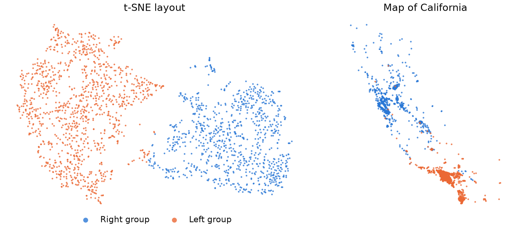
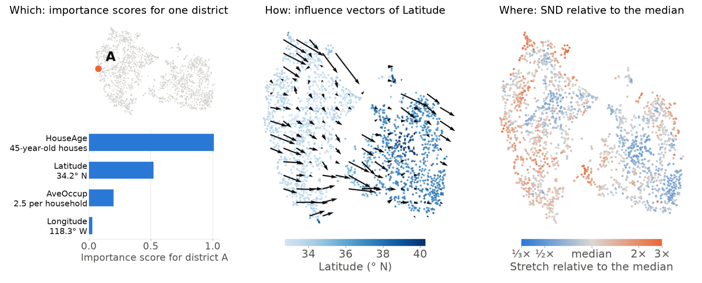

<center>
<h1><b>FADEx</b></h1>
Feature Attribution and Distortion-based Explanation of Dimensionality Reduction

[](https://pypi.org/project/fadex-exp/)
[](https://pypi.org/project/fadex-exp/)
[](https://opensource.org/licenses/MIT)
[](https://arxiv.org/abs/2607.27463)
</center>

---

**FADEx** is a local explainability method for dimensionality reduction (DR) algorithms. It approximates the DR mapping locally using a **weighted ridge least-squares** fit and derives per-feature importance scores through a **Singular Value Decomposition (SVD)** of the estimated Jacobian matrix.

When the data is mapped to a two-dimensional space by the DR algorithm, the importance of each high-dimensional feature $j$ is given by:

$$
\phi_j = \left|v_{1j}\, x_j\right| + \frac{\lambda_2}{\lambda_1} \left|v_{2j}\, x_j\right|
$$

where $v_{ij}$ denotes the $j$-th entry of the $i$-th right singular vector, $\lambda_i$ is the $i$-th singular value, and $x_j$ is the value of feature $j$.

The **spectral norm** of the Jacobian (SND) is used as a local distortion measure: the largest local stretch of the neighborhood around each point.

From one estimated Jacobian per point, FADEx gives three explanations:

- **Which** features matter: one importance score per feature, per point.
- **How** they act: the influence vector of a feature (a column of the Jacobian) is the direction in the embedding that the local model predicts for a small increase in that feature.
- **Where** the embedding is stretched: the SND of each point.

FADEx uses only the data and the finished embedding. It does not need the DR algorithm to place new points, so it works with any DR method.

---

# Paper

FADEx will be published in **IEEE Transactions on Visualization and Computer Graphics (TVCG)**. A preprint is available on arXiv:

> Lucas Greff Meneses, Evandro S. Ortigossa, Claudio Silva, Luis Gustavo Nonato.
> **FADEx: Feature Attribution and Distortion-based Explanation of Dimensionality Reduction.**
> arXiv:2607.27463, 2026.

**[Read the preprint on arXiv »](https://arxiv.org/abs/2607.27463)**

```bibtex
@article{meneses2026fadex,
  title   = {FADEx: Feature Attribution and Distortion-based Explanation of Dimensionality Reduction},
  author  = {Meneses, Lucas Greff and Ortigossa, Evandro S. and Silva, Claudio and Nonato, Luis Gustavo},
  journal = {arXiv preprint arXiv:2607.27463},
  year    = {2026}
}
```

The paper is presented at **IEEE VIS 2026**. The slides are in [`talk/`](talk/) as a Quarto reveal.js deck; run `quarto render talk/fadex-talk.qmd` to build them. An introductory deck that uses the California Housing example throughout is in [`talk-intro/`](talk-intro/).

---

# Installation

```bash
pip install fadex-exp
```

---

# Quick Start

```python
from fadex import FADEx
from sklearn.manifold import TSNE
from sklearn.preprocessing import StandardScaler

# Fit your DR algorithm
X_scaled = StandardScaler().fit_transform(X)
X_embedded = TSNE(n_components=2).fit_transform(X_scaled)

# Create FADEx explainer
fadex = FADEx(
    high_dim_data=X_scaled,
    low_dim_data=X_embedded,
    n_neighbors=30,
    feature_names=feature_names,
    class_names=class_labels,
)

# Explain a single instance
result = fadex.fit(explain_index=0)

# Global feature importance plot
fadex.importance_plot()

# Interactive embedding plot
fadex.interactive_plot()
```

---

# Example: California Housing

A dataset that ships with scikit-learn, where the answer can be checked by eye: two of the eight features are latitude and longitude.



t-SNE splits the districts into two groups, which turn out to be Southern and Northern California. The layout alone does not say which features place each district.

```python
import numpy as np
from sklearn.datasets import fetch_california_housing
from sklearn.manifold import TSNE
from sklearn.preprocessing import StandardScaler
from fadex import FADEx

data = fetch_california_housing()
rows = np.random.default_rng(0).choice(len(data.data), 2000, replace=False)
X = StandardScaler().fit_transform(data.data[rows])
Y = TSNE(n_components=2, perplexity=50, random_state=0).fit_transform(X)

fadex = FADEx(high_dim_data=X, low_dim_data=Y, n_neighbors=200,
              feature_names=list(data.feature_names))

fadex.fit(explain_index=0)                      # which: scores for one district
fadex.plot_grid_feature_vectors("Latitude")     # how: influence vectors of one feature
fadex.plot_distortion()                         # where: the SND map

quality = fadex.fit_quality(n_points=300, baseline=True)
print(quality["mean_cosine"], quality["baseline_cosine"])   # about 0.84 against 0.53
```



Left: for one district in the Los Angeles area, house age gets the highest score. Middle: the Latitude vectors point from the southern group to the northern one. Right: neighborhoods stretched more (orange) or less (blue) than the median.

These figures were drawn from FADEx's output with the plotting code in [`talk/california_figs.py`](talk/california_figs.py), so they are styled differently from the package's built-in plots, and the district shown is not the one with index 0. Nothing about t-SNE is passed to FADEx, so replacing it with another DR method changes one line.

---

# Reading the Outputs

- **Standardize the features first.** The importance score multiplies a sensitivity by how far the feature is from the reference point (the dataset mean by default), so it depends on how features are scaled. A feature scores high only when the embedding is sensitive to it at that point **and** the point is unusual on it. The score is not the length of the influence vector.
- **Influence vectors are predictions of the fitted local model**, valid for small changes. They are not the result of rerunning the DR algorithm with a changed point, and with correlated features a single vector should be read with care.
- **SND is the largest local stretch only**, in embedding units per data unit. Compare values within one embedding rather than reading the absolute number. A low SND does not by itself mean that a neighborhood is shown faithfully.
- **Check the fit.** FADEx assumes the embedding is locally smooth. `fit_quality(baseline=True)` tells you when that holds: compare `"mean_cosine"` with `"baseline_cosine"`, which is about 0.5 and not 0.
- **Neighborhood size.** About 10% of the dataset is a good starting point for `n_neighbors`. Strongly curved embeddings need fewer.

---

# Distances other than Euclidean

Many DR methods can be run with another distance (for example `metric="cosine"` in UMAP or `distance="angular"` in PaCMAP). Pass the same choice to FADEx with `metric`. SND then becomes the largest displacement in the embedding **per unit of that distance**.

| `metric` | Neighbors and weights | Local model | SND |
|----------|----------------------|-------------|-----|
| `"euclidean"` (default) | Euclidean | Jacobian over the features | Spectral norm of the Jacobian |
| `"manhattan"` | Manhattan (L1) | Jacobian over the features | Largest column norm of the Jacobian, i.e. the longest influence vector |
| `"cosine"` | Angle between rows | Jacobian fitted in the tangent space of the unit sphere at the instance, then mapped back to the features | Stretch per radian |
| `"precomputed"` | The given distance matrix | Linear map fitted in local MDS coordinates | Largest singular value of that map |

```python
# A layout made with the cosine distance
fadex = FADEx(X, Y, n_neighbors=200, metric="cosine")

# Only a distance matrix is available (no features)
fadex = FADEx(D, Y, n_neighbors=200, metric="precomputed")
out = fadex.fit(0)            # out["SND"], out["singular_values"], out["negative_share"]
fadex.plot_distortion()
fadex.fit_quality(n_points=300, baseline=True)
```

- **Cosine.** Rescaling a row changes nothing: the Jacobian satisfies `J @ x = 0` and SND does not depend on the row lengths. If the DR method centers the data before measuring angles, center it the same way before calling FADEx.
- **Precomputed.** There are no features, so `fit()` returns `"phi"` and `"jac"` as `None`, and `importance_plot`, `fit_cluster`, `plot_grid_feature_vectors` and `plot_feature_heatmap` raise an error. `fit()`, `fit_quality()`, `plot_distortion()` and `interactive_plot()` work. `"negative_share"` is 0 when the distances are Euclidean; a large value means the local coordinates distort the distances and SND is less reliable. With Euclidean distances this mode gives the same SND as `use_pca=True` on the features, up to small differences in the kernel weights.
- **SND values are not comparable across metrics.** A unit of Manhattan distance is not a unit of Euclidean distance. `"manhattan"` takes the largest stretch over every possible direction, which is reached by changing one feature alone; `"precomputed"` with Manhattan distances only sees the directions present in the data, and is smaller.
- **Hamming distance** on binary or one-hot data equals the squared Euclidean distance, so the neighborhoods are the same and the default metric can be used.
- **Fit quality.** Matching the metric makes FADEx consistent with the DR method; in our tests it did not raise `fit_quality` scores. Compare each score with its own `baseline=True` value.

---

# FADEx Class

## Constructor

```python
FADEx(
    high_dim_data,
    low_dim_data,
    n_neighbors     = None,
    feature_names   = None,
    class_names     = None,
    remove_const_feat = False,
    use_pca         = False,
    ridge_lambda    = 0.1,
    verbose         = False,
    reference       = "mean",
    metric          = "euclidean",
)
```

### Required Parameters

| Parameter | Shape | Description |
|-----------|-------|-------------|
| `high_dim_data` | `(n_samples, n_features)` | Dataset in the original high-dimensional space |
| `low_dim_data` | `(n_samples, d)` | Dataset in the reduced space produced by the DR algorithm |

### Optional Parameters

| Parameter | Default | Description |
|-----------|---------|-------------|
| `n_neighbors` | `None` | Number of neighbors for the local Jacobian estimation. `None` uses the entire dataset |
| `feature_names` | `None` | List of feature names. Auto-generated if not provided |
| `class_names` | `None` | Class label for each instance, used in plot tooltips |
| `remove_const_feat` | `False` | Drops near-constant features before Jacobian estimation to reduce effective dimensionality. Recommended, together with `use_pca`, for data with more than about 50 features |
| `use_pca` | `False` | Applies PCA (95% variance retained) before Jacobian estimation to reduce effective dimensionality. Recommended, together with `remove_const_feat`, for data with more than about 50 features |
| `ridge_lambda` | `0.1` | Regularization strength for the weighted ridge least-squares solver |
| `verbose` | `False` | Prints debug information during computation |
| `reference` | `"mean"` | Reference point for the importance scores: the score of feature $j$ uses the displacement $x_j - \text{reference}_j$. `"mean"` uses the dataset mean, so scores do not change when a constant is added to a feature. `"zero"` uses the raw values, exactly as in the formula above; the two coincide for centered (e.g. standardized) data. An array with one value per feature is also accepted. The Jacobian, the influence vectors and SND do not depend on it |
| `metric` | `"euclidean"` | Distance used in the original space: `"euclidean"`, `"manhattan"`, `"cosine"` or `"precomputed"`. It sets the neighborhoods, the kernel weights and the unit of SND. With `"precomputed"`, `high_dim_data` is an `(n_samples, n_samples)` distance matrix. See [Distances other than Euclidean](#distances-other-than-euclidean) |

---

## Methods

### `fit`

```python
result = fadex.fit(
    explain_index,
    show     = True,
    width    = 10,
    height   = 8,
    n_top    = 10,
    save_fig = False,
)
```

Computes the FADEx explanation for a single instance. Returns a dict with keys `"phi"` (importance scores), `"SND"` (spectral norm of the Jacobian, the local distortion measure), `"jac"` (the estimated Jacobian), and `"feature_names_top"`. When `show=True`, displays a feature importance bar chart for that instance.

---

### `fit_quality`

```python
quality = fadex.fit_quality(
    indices      = None,
    n_points     = None,
    test_size    = 0.3,
    random_state = 0,
    baseline     = False,
)
```

Checks whether the local linear model can be trusted. For each instance, the Jacobian is estimated from 70% of its neighbors and used to predict where the other 30% lie in the embedding. Returns a dict with the per-instance `"cosine"` (direction agreement) and `"pearson"` (agreement of displacement lengths), their averages `"mean_cosine"` and `"mean_pearson"`, and the evaluated `"indices"`. Use `n_points` to evaluate a random sample.

An embedding unrelated to the data does **not** score 0 on the cosine measure. Pass `baseline=True` to also get `"baseline_cosine"` and `"baseline_pearson"`, the same scores for a randomly permuted embedding, and compare against those.

---

### `fit_cluster`

```python
result = fadex.fit_cluster(
    cluster_ids,
    n_top    = 10,
    show     = False,
    save_fig = False,
)
```

Computes a cluster-level importance by averaging `phi` over all instances in `cluster_ids`. Returns a dict with keys `"phi_cluster"` and `"feature_names_top"`. Useful for understanding which features drive a specific group of points in the embedding.

---

### `importance_plot`

```python
fadex.importance_plot(
    width    = 8,
    height   = 8,
    n_top    = 10,
    save_fig = False,
)
```

Runs FADEx on the entire dataset, sums `phi` across all instances, and plots a global feature importance ranking.

---

### `interactive_plot`

```python
fadex.interactive_plot(
    width         = 10,
    height        = 8,
    show_features = False,
)
```

Displays an interactive Plotly scatter plot of the 2D embedding. Points are colored by their spectral norm, and hovering over a point shows its class, index and spectral norm. With `show_features=True` the tooltip also lists the feature importances.

---

### `plot_distortion`

```python
fadex.plot_distortion(
    width    = 10,
    height   = 10,
    save_fig = False,
)
```

Plots the 2D embedding colored by the SND distortion measure, with the color scale centered at 1 (cold colors below 1, warm colors above). SND compares embedding units with data units, so its absolute value depends on how both are scaled.

---

### `plot_grid_feature_vectors`

```python
fadex.plot_grid_feature_vectors(
    feature,
    labels       = None,
    mask         = None,
    grid_bins    = 15,
    min_points   = 1,
    scale_factor = 1.0,
    width        = 12,
    height       = 10,
    save_fig     = False,
)
```

Overlays Jacobian-based feature vectors on the 2D embedding using a grid. The embedding plane is divided into a `grid_bins × grid_bins` grid; for each occupied cell, the mean Jacobian is computed and the selected feature is drawn as an arrow. Arrow color encodes magnitude — vectors with norm ≥ 1 are capped to unit length and colored by their original magnitude.

`feature` accepts a feature name (string) or a column index (integer).

---

### `plot_feature_heatmap`

```python
fadex.plot_feature_heatmap(
    feature,
    gridsize = 30,
    cmap     = 'magma',
    width    = 10,
    height   = 8,
    save     = False,
)
```

Renders a hexbin heatmap on the 2D embedding showing where a specific feature has the highest importance. The background is set to the darkest tone of the colormap for visual contrast, and real data points are shown as faint white dots for spatial context.

`feature` accepts a feature name (string) or column index (integer).

---

# Acknowledgments

This work was supported by the São Paulo Funding Agency (FAPESP), grants 2022/09091-8, 2025/10383-1 and 2025/18911-7, and by the Brazilian National Council for Scientific and Technological Development (CNPq), grant 307184/2021-8. Ortigossa was supported by the Paulo Pinheiro de Andrade Fellowship. Silva was partially supported by the National Science Foundation, grant OAC-2411221, and the DARPA expMath program. Any opinions, findings, and conclusions or recommendations expressed in this material are those of the authors and do not necessarily reflect the views of the funding agencies and institutions they are affiliated with.

---
