## The data: housing districts in California

:::: {.columns}
::: {.column width="40%"}
* 20,640 districts from the 1990 census; we use a random sample of 2,000
* Each dot is one district, drawn where it sits on the map
* Darker means more expensive houses: the coast near San Francisco and Los Angeles stands out
:::
::: {.column width="60%"}
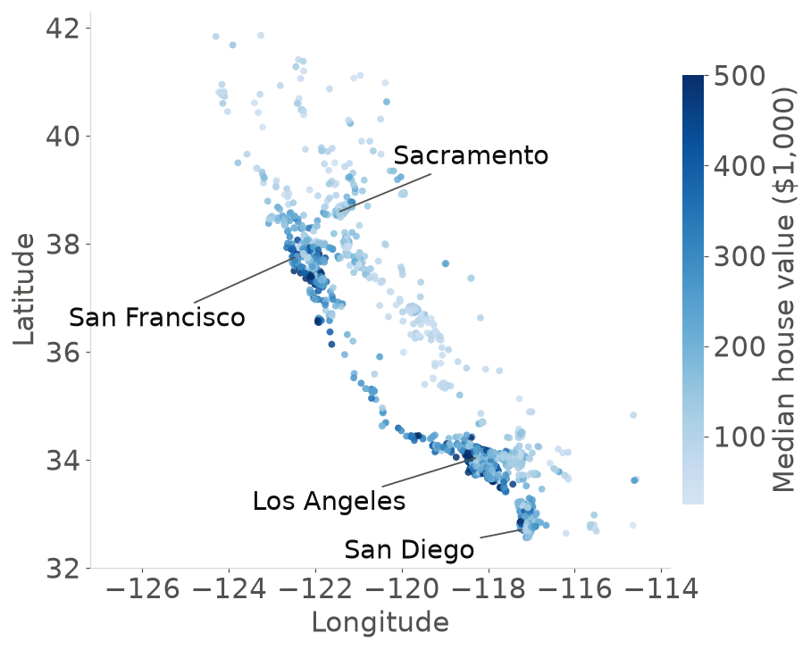{height="760" fig-align="center"}
:::
::::

::: {.notes}
This is the California Housing dataset that ships with scikit-learn. A district is a census
block group, typically about 1,200 people.

Everyone has an intuition for this data: where things are, and that houses by the coast
cost more. That makes it a good place to check whether an explanation makes sense.

House value is the thing people usually predict. We are not predicting anything today. We
only use it to colour the pictures.
:::

## Eight numbers describe each district

| Feature | What it means | Typical district |
|---|---|---|
| MedInc | Median household income | $35,000 |
| HouseAge | Median age of the houses | 29 years |
| AveRooms | Rooms per household | 5.3 |
| AveBedrms | Bedrooms per household | 1.05 |
| Population | People living in the district | 1,200 |
| AveOccup | People per household | 2.8 |
| Latitude | How far north | 34.2° N |
| Longitude | How far east | 118.5° W |

: {tbl-colwidths="[22,48,30]"}

::: {.notes}
"Typical" is the median of our sample.

Two of the eight features are the position on the map. That is what will let us check the
explanations by eye later.

We cannot draw eight axes on a screen. So we need a way to turn eight numbers into two.
Before projecting, every feature is standardized, so that Population, in the thousands,
does not drown out Bedrooms.
:::

## A projection squeezes eight numbers into two

**It places similar districts close together. Three methods give three different pictures of the same data.**

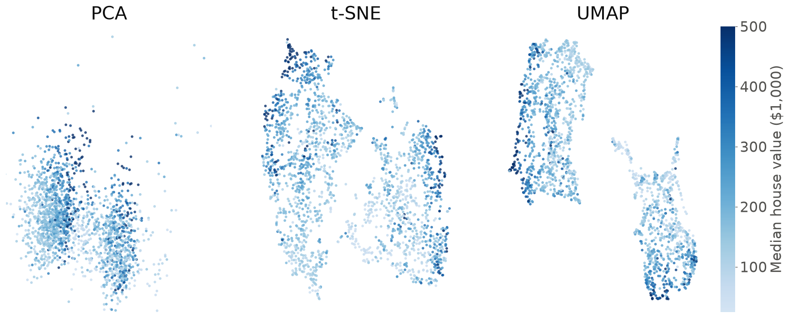{fig-align="center"}

::: {.notes}
Each dot is still one district. Now its position is chosen by an algorithm so that
districts with similar feature values end up near each other.

PCA is the classic linear method. t-SNE and UMAP are nonlinear and are what most people use
today, because they often separate groups more visibly. A picture with clearer groups is
not necessarily a more faithful one; we come back to that under "where".

Same 2,000 districts, same colour. The pictures disagree. Which one is right? What do the
groups mean? What do the axes mean? For t-SNE and UMAP the axes mean nothing at all.
:::

## PCA is the easy case: every feature has one arrow

:::: {.columns}
::: {.column width="40%"}
* Each axis is a fixed blend of all eight features: PC 1 is mostly location, PC 2 mostly house size
* Because the blend is the same everywhere, each feature pushes every district in one fixed direction
* Increase Latitude and a district moves right and down, wherever it starts
* A long arrow means the feature matters a lot for the picture
:::
::: {.column width="60%"}
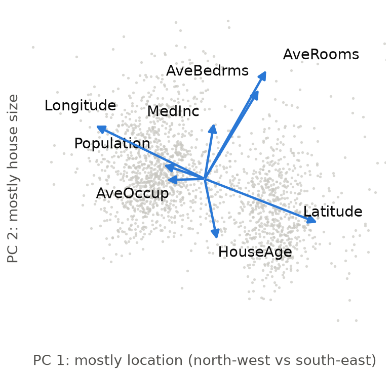{height="760" fig-align="center"}
:::
::::

::: {.notes}
This is called a biplot, and it is why PCA is considered interpretable. The arrows are the
explanation.

The axes are not single features. PC 1 weights Latitude 0.60 and Longitude minus 0.58, with
smaller weights on the rest. PC 2 weights rooms 0.61 and bedrooms 0.50, with income up and
house age down. A feature's arrow is just its pair of weights, so there is one arrow per
feature for the whole picture, not one per district.

Read it: Latitude and Longitude point in opposite directions, because California runs from
north-west to south-east, so going north means going west. Rooms and Bedrooms point the
same way.

The price of this simplicity: these two axes keep only about half of the variation in the
data, 26 plus 23 percent.
:::

## For PCA, the arrows are the whole explanation

:::: {.columns}
::: {.column width="42%"}
::: {style="font-size: 0.8em;"}
| Feature | Weight in PC 1 | Weight in PC 2 |
|---|---|---|
| MedInc | 0.05 | 0.32 |
| HouseAge | 0.07 | −0.34 |
| AveRooms | 0.33 | 0.61 |
| AveBedrms | 0.29 | 0.50 |
| Population | −0.22 | 0.08 |
| AveOccup | −0.21 | −0.01 |
| Latitude | 0.60 | −0.25 |
| Longitude | −0.58 | 0.30 |

: {tbl-colwidths="[36,32,32]"}
:::
:::
::: {.column width="58%"}
* The two **columns** are the axes; each **row** is one feature's arrow
* **How:** raise a feature by one unit and every district moves by that feature's arrow
* **Which:** the longer the arrow, the more the picture responds to that feature
* **Where:** nothing to report, because PCA never stretches a neighbourhood
* It explains the picture, not the data: these two axes keep only 49% of the variation
:::
::::

::: {.notes}
This is the same information as the arrows on the previous slide, as numbers. PCA centres
the data and finds two directions in the eight-dimensional feature space. Those are the two
columns. A district's horizontal position is its features weighted by the first column, its
vertical position by the second.

Read a row and you get an arrow. Latitude is 0.60 right and 0.25 down.

How, which and where are the three questions we will ask of every projection in this talk.
For PCA all three are answered by this one table, and the answers are the same for every
district. That is what "interpretable" means here.

The last bullet is a caution that stays true for the rest of the talk. Population and
occupancy have short arrows. That does not make them unimportant in the data. It means they
mostly live in the directions PCA threw away.

Next: t-SNE and UMAP give better-looking groups, and no table like this.
:::

## t-SNE shows groups, but comes with no arrows

**The usual way to explain it: colour the layout by each feature in turn, and look for a pattern.**

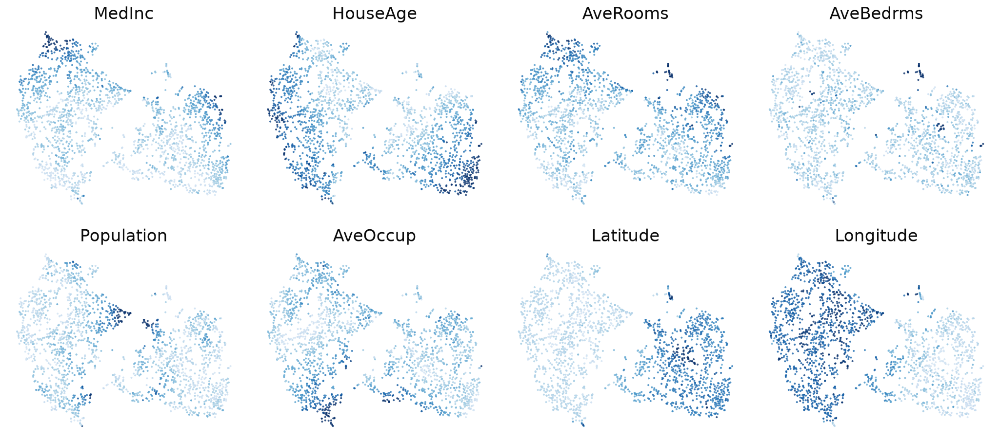{fig-align="center"}

::: {.notes}
This is the t-SNE layout eight times, coloured by one feature each time.

It works here. Look at Latitude and Longitude: the two big groups have different colours.
The other six do not separate the groups.

But this is eight pictures for eight features. With a hundred features it is a hundred
pictures. And it only shows patterns across the whole layout. It does not tell me why this
particular district is here, or what would move it.
:::

## The two groups are Southern and Northern California

**t-SNE's main split is geography: latitude, one of the eight features, separates its two groups for 97% of districts.**

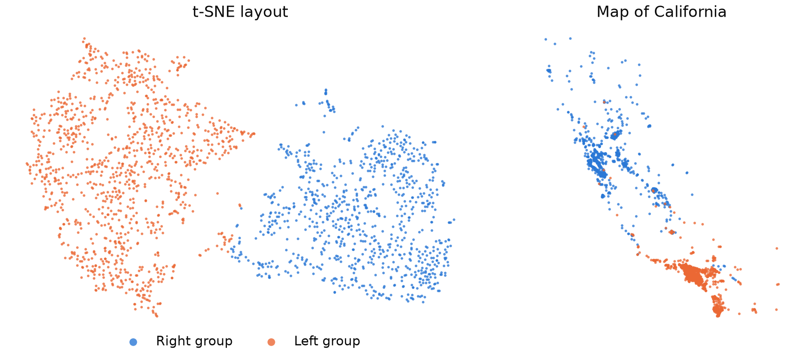{fig-align="center"}

::: {.notes}
Left: the t-SNE layout, split into its two groups. Right: the same districts on the map,
with the same colours.

Orange is Los Angeles and San Diego. Blue is the Bay Area, Sacramento and the Central
Valley. Splitting at 36 degrees north reproduces the grouping for 97 percent of districts.

So t-SNE's main structure is geography. That is no mystery: latitude and longitude are two
of the eight inputs. The open question is which features place one particular district.
We found the geography by trying colours. FADEx is a way to
get this kind of answer directly, and for each district.
:::

## The idea of FADEx: a set of arrows at every point

:::: {.columns}
::: {.column width="40%"}
* A curved rule looks straight if you zoom in far enough
* So around each district, FADEx fits a small straight-line rule, like PCA's, valid only nearby
* The result is a local set of arrows, one per feature, that changes from place to place
:::
::: {.column width="60%"}
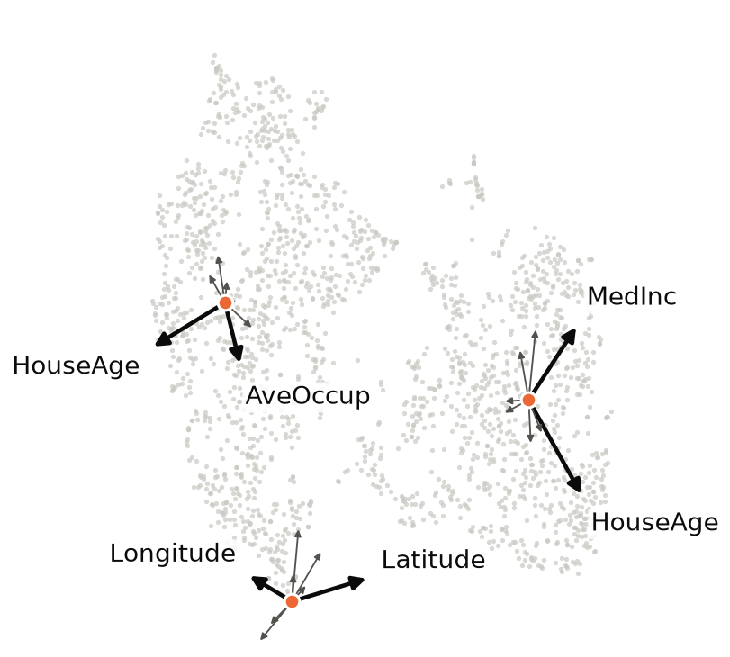{height="760" fig-align="center"}
:::
::::

::: {.notes}
Three districts, each with its own eight arrows. The two longest are labelled.

In the bottom district, Latitude and Longitude are the long arrows. In the one on the
right, it is income and house age. In PCA these would be the same arrows everywhere. Here
they are not, and that difference is exactly what makes t-SNE hard to read.

The name: Feature Attribution and Distortion-based Explanation.
:::

## How FADEx gets the arrows

1. Pick a district and find its most similar districts in the data (here, the 200 nearest)
2. Look at where the projection placed all of them
3. Fit the straight-line rule that best turns "difference in features" into "difference in position", trusting close neighbours more than distant ones

FADEx never asks the projection to place a new point. It only needs **the data and the finished layout**, so it works with any projection method.

::: {.notes}
Step 3 is a weighted least-squares fit. In the paper the rule is called the Jacobian of the
projection.

The last line matters in practice. Standard t-SNE has no way to place a new point without
rerunning (some implementations, such as openTSNE, add one), so methods that explain by
nudging a point and re-projecting it need extra machinery. FADEx only looks at what is
already there.

If asked whether this is a surrogate method like LIME: it is a local linear approximation,
so the word fits. The difference is that it is fitted to existing neighbours, without
generating or projecting additional samples.

From this one fitted rule we read three things: how each feature moves a point, which
features matter most, and how much the neighbourhood was stretched. The next slides take
them one at a time.
:::

## The mathematics, 1: the local rule is a table of numbers

The projection $M$ turns a district's 8 features $\mathbf{x}$ into 2 layout coordinates. For a small change $\mathbf{h}$:

$$M(\mathbf{x}+\mathbf{h}) \;\approx\; M(\mathbf{x}) + J\,\mathbf{h}$$

$J$ has 2 rows and 8 columns, and **each column is one feature's arrow**. For district A:

::: {style="font-size: 0.8em;"}
| | MedInc | HouseAge | AveRooms | AveBedrms | Population | AveOccup | Latitude | Longitude |
|---|---|---|---|---|---|---|---|---|
| horizontal | −5.2 | −11.5 | −4.3 | −1.9 | −2.0 | 1.8 | 13.0 | −0.4 |
| vertical | 10.5 | −0.9 | 5.9 | −2.4 | −2.3 | −4.7 | −3.5 | 0.6 |

: {tbl-colwidths="[12,11,11,11,11,11,11,11,11]"}
:::

FADEx picks the $J$ that best explains where the neighbours $\mathbf{x}_\ell$ landed ($\mathbf{y}_\ell$), nearer ones counting more:

$$\min_J \;\sum_{\ell=1}^{k} w_\ell\,\bigl\|(\mathbf{y}_\ell-\mathbf{y}) - J\,(\mathbf{x}_\ell-\mathbf{x})\bigr\|^2 \;+\; \alpha\,\|J\|^2 \qquad\quad w_\ell = e^{-r_\ell^2/2\sigma^2}$$

::: {.notes}
M is the projection method itself, t-SNE here, seen as a function: it takes a district's
eight features and returns its position in the layout. We have no formula for M. We only
see where it put each point.

The first equation approximates M near one point x by a linear map, a first-order Taylor
expansion. It holds for small h around this x, and every point gets its own J. J is the
Jacobian of the projection at x: the table of all sixteen "how much does this coordinate
change when that feature changes" numbers.

Read the table by column, as a local rate of change: 13 layout units right and 3.5 down
per standard deviation of latitude. That is for reading the units; the linear rule is only
trusted for small changes. Income points up. These are the arrows from the previous
picture, as numbers.

A column is a prediction of the fitted rule, not a rerun of t-SNE with a changed district.
When features are correlated, read a single column with care.

t-SNE gives us no formula for J, so we estimate it. The second equation is weighted least
squares: r is the distance from x to the neighbour, sigma is the median of those distances,
and the alpha term (0.1) keeps the answer stable when neighbours are unevenly spread. It
has a closed-form solution; here it is one 8-by-8 linear system per district.
:::

## The mathematics, 2: reading scores and stretch from J

:::: {.columns}
::: {.column width="60%"}
Decompose the table (SVD): $J = U\,\Sigma\,V^{\top}$

* $J$ turns a small ball around the district into an ellipse in the layout
* **Two directions** in feature space, $\mathbf{v}_1$ and $\mathbf{v}_2$, become its axes, of lengths $\lambda_1 \ge \lambda_2$
* **Stretch** is the long axis, $\lambda_1$
* **Importance** of feature $j$ is its share of those two directions, times the district's own value $x_j$:

$$\phi_j \;=\; \bigl|v_{1j}\,x_j\bigr| \;+\; \frac{\lambda_2}{\lambda_1}\,\bigl|v_{2j}\,x_j\bigr|$$

:::
::: {.column width="40%"}
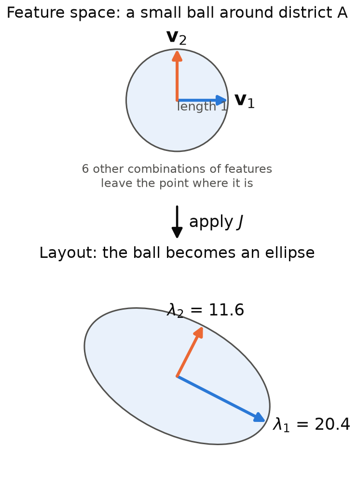{height="800" fig-align="center"}
:::
::::

::: {.notes}
The picture uses district A's real numbers. Take every district that differs from A by one
standard deviation in total, in any combination of features: that is the ball. The local
rule sends that ball to the ellipse below, 20.4 layout units along its long axis and 11.6
along its short one, tilted as drawn.


V holds the two directions in the 8-dimensional feature space that the layout can see near
this district. Moving the district along any direction perpendicular to both changes
nothing in the layout. Sigma holds how strongly each direction is magnified: 20.4 and 11.6
for district A.

The stretch measure in the paper is called SND, the spectral norm of J, which is lambda 1.
It is one number for the long axis only. It says nothing about the short axis, so a
neighbourhood can be squeezed hard in one direction and still have a moderate stretch.

The score: v-one-j is feature j's share of the strongest direction, v-two-j its share of
the second, down-weighted by the ratio of strengths. Multiplying by x_j, the standardized
feature value, turns sensitivity into contribution.

The next slide works the score through for district A.
:::

## The mathematics, 3: the importance score, step by step

:::: {.columns}
::: {.column width="56%"}
::: {style="font-size: 0.8em;"}
| Feature | Weight in $\mathbf{v}_1$ | Weight in $\mathbf{v}_2$ | A's value $x_j$ | Score $\phi_j$ |
|---|---|---|---|---|
| MedInc | 0.46 | 0.61 | −0.02 | 0.02 |
| HouseAge | 0.48 | −0.52 | 1.30 | **1.01** |
| AveRooms | 0.32 | 0.29 | 0.02 | 0.01 |
| AveBedrms | 0.03 | −0.26 | −0.06 | 0.01 |
| Population | 0.04 | −0.26 | 0.13 | 0.02 |
| AveOccup | −0.18 | −0.29 | −0.58 | 0.20 |
| Latitude | −0.65 | 0.24 | −0.67 | **0.52** |
| Longitude | 0.03 | 0.03 | 0.61 | 0.03 |

: {tbl-colwidths="[24,19,19,19,19]"}
:::
:::
::: {.column width="44%"}
1. **Weights:** how much each feature takes part in the two directions the layout responds to
2. **Value:** how far district A is from the average district on that feature
3. **Score:** multiply them, and add the two directions, discounting the weaker one by $\lambda_2/\lambda_1 = 0.57$

HouseAge: $|0.48 \times 1.30| + 0.57\,|{-0.52} \times 1.30| = 1.01$
:::
::::

**A feature scores high only when the layout is sensitive to it here *and* the district is unusual on it.**

::: {.notes}
This is district A again, all eight features.

The weights come from the decomposition on the previous slide. v1 and v2 are each a list of
eight numbers, one per feature.

The value is standardized, so zero means an average district and 1.3 means 1.3 standard
deviations above average.

Read three rows. Income has large weights in both directions, so the layout is very
sensitive to income here, but A's income is average, so the score is 0.02. Longitude is the
opposite: A is well off average, but the layout barely responds to longitude at this spot,
so 0.03. House age and Latitude are high on both counts.

What the number means: take feature j alone, at this district's value, and push it through
the local rule. It moves the point by some amount along each axis of the ellipse. The score
is the size of those two movements added up, in units of the local stretch. Roughly: how
far would this district move if feature j went from average to its actual value.

Two consequences. The score is not the arrow length, so the "which" and "how" pictures can
disagree. And it is measured against the average district, so it depends on how features
are centred and scaled.

The formula in the paper uses the feature's own value. The package by default uses the
distance from the dataset mean. The two are the same here because the data is standardized;
they differ on data that is not centred.
:::

## Sanity check: on PCA, FADEx recovers PCA's own arrows

**Where we know the answer, FADEx finds it. On t-SNE, the same feature gets a different arrow in each region.**

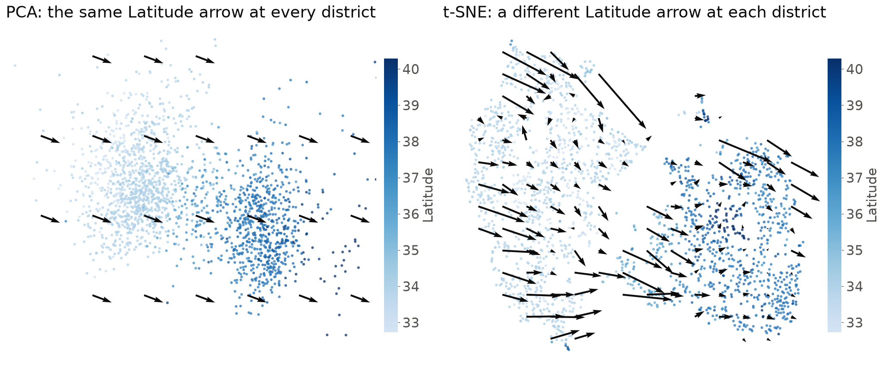{fig-align="center"}

::: {.notes}
Left: FADEx applied to the PCA layout, arrows for Latitude. All parallel, all the same
length, and they match the true PCA arrow to within 0.01. FADEx was not told this was PCA.

Right: the same thing on t-SNE. The arrows mostly point from the southern group toward the
northern one, but direction and length vary.

Each arrow is the average over the districts in a grid cell.
:::

## How: arrows show where a feature pushes

**Latitude arrows run from the southern group to the northern; Longitude arrows run back.**

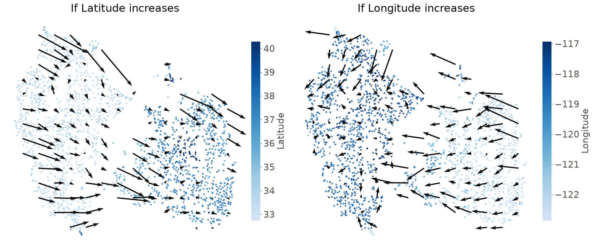{fig-align="center"}

::: {.notes}
Read an arrow as: if this district's latitude went up a little, this is the direction it
would move in the layout.

Left: almost every arrow points from the light, southern group toward the dark, northern
one. Increase latitude, move toward Northern California. That is what we would hope.

Right: longitude does the opposite, because going east in California means going south.

So the arrows give us the geography reading from before, without trying colours.

An arrow is not the same thing as the colour gradient. The colours show where the
high-latitude districts ended up. The arrow shows how the layout responds to latitude alone,
with the other seven features held fixed, much like a regression coefficient. Here the two
agree, which is our sanity check. They do not have to, and when they differ the arrow is
telling you something colouring cannot.

"Would move" is the local rule's prediction. t-SNE cannot re-place one changed district. The
arrow describes the trend among the district's real neighbours, so trust it for small
changes, not for jumping across the gap between the groups.
:::

## How: the arrows also explain structure inside a group

**Income arrows point up, toward the expensive districts; house-age arrows point to the old neighbourhoods.**

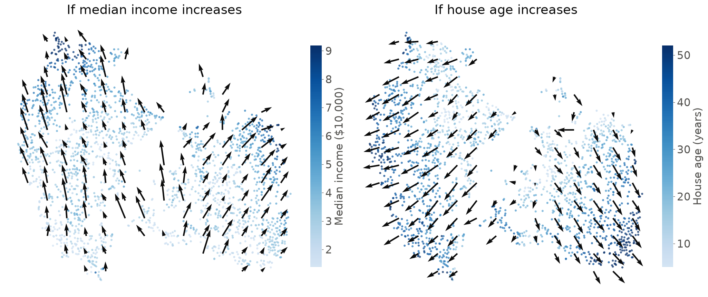{fig-align="center"}

::: {.notes}
Geography explains the split into two groups. What organizes each group internally?

Left: median income. The arrows point up in both groups, and the dark, high-income
districts sit at the top. So inside each group, up means richer.

Right: house age. The arrows point toward the dark regions, the old neighbourhoods: the
left edge of the southern group and the bottom right of the northern one.

Now the layout has something like axes, but local ones.
:::

## Which: one importance score per feature, per district

**The same arrows, turned into a ranking: which features matter most for placing this particular district?**

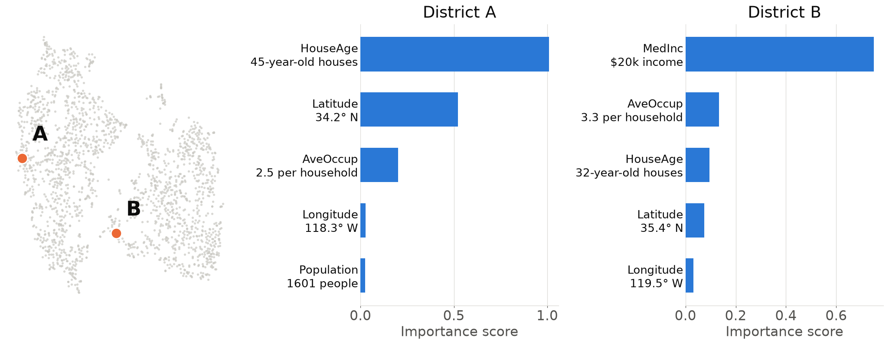{fig-align="center"}

::: {.notes}
District A is in the Los Angeles area. Its houses are 45 years old, against a typical 29.
House age gets the top score.

District B is inland, near Bakersfield. Its median income is 20 thousand dollars, against a
typical 35. Income gets the top score.

The score combines two things: how sensitive the layout is to the feature at that spot,
and how unusual the district's value is. So read it as "what makes this district sit
where it does", not as sensitivity alone.
:::

## Which: the top feature changes across the layout

:::: {.columns}
::: {.column width="40%"}
* Each district is coloured by its top-scoring feature
* House age leads for 30% of districts, Latitude for 23%, Longitude for 15%
* Regions of one colour are districts that sit where they do for the same reason
:::
::: {.column width="60%"}
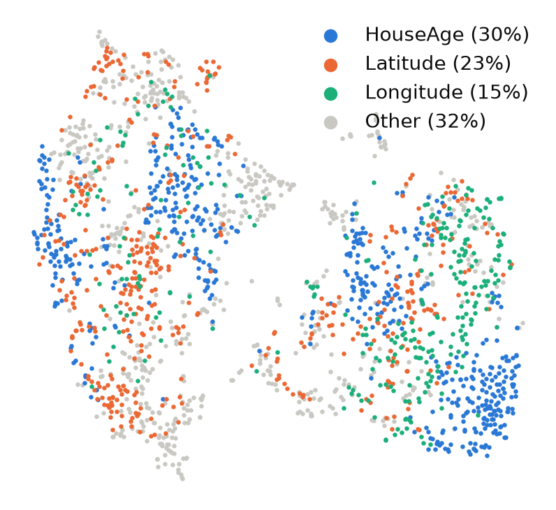{height="760" fig-align="center"}
:::
::::

::: {.notes}
The blue patch at the bottom right is the region of old houses we saw on the previous
slide. There, house age is what places a district.

"Other" collects the remaining five features, which together lead for about a third of the
districts. Bedrooms almost never leads.

This is one picture instead of eight, and it is specific to each district.
:::

## Where: the layout is stretched unevenly

**The two extremes: the most stretched district has its truly similar districts scattered; the least keeps them close.**

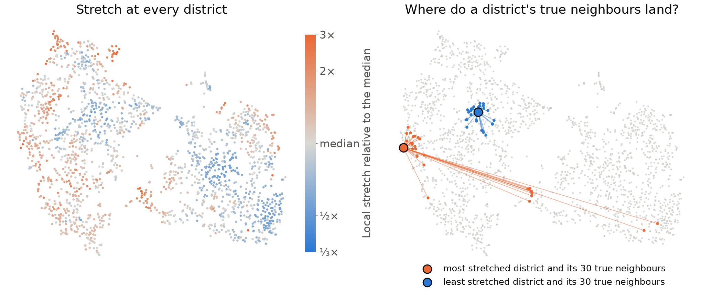{fig-align="center"}

::: {.notes}
Every projection distorts. Eight dimensions do not fit in two. The question is where.

Left: the fitted rule also tells us how much each neighbourhood was stretched. Orange is
stretched more than the median district, blue less.

Right is the check. Take the most stretched district, find its 30 most similar districts in
the real data, and draw them. They land all over the layout, 18 units away on average. For
the least stretched district they sit right around it, 3 units away.

The stretch is shown relative to the median because layout units are arbitrary: t-SNE
coordinates can be any size.

The right panel shows the two extremes. Over all 2,000 districts the relation is moderate:
the rank correlation between a district's stretch and how far its 30 true neighbours land,
relative to their real distance, is 0.47. The 5 percent most stretched districts have
their true neighbours 10.7 layout units away on average, the 5 percent least stretched 3.0.

Stretch is the largest local stretch only. A low value does not by itself prove that a
neighbourhood is shown faithfully.
:::

## What does each projection pay attention to?

:::: {.columns}
::: {.column width="40%"}
* t-SNE and UMAP agree: location, house age and income
* PCA spends more on Latitude, Longitude and rooms
* The same explainer runs on all three, so the comparison is like for like
:::
::: {.column width="60%"}
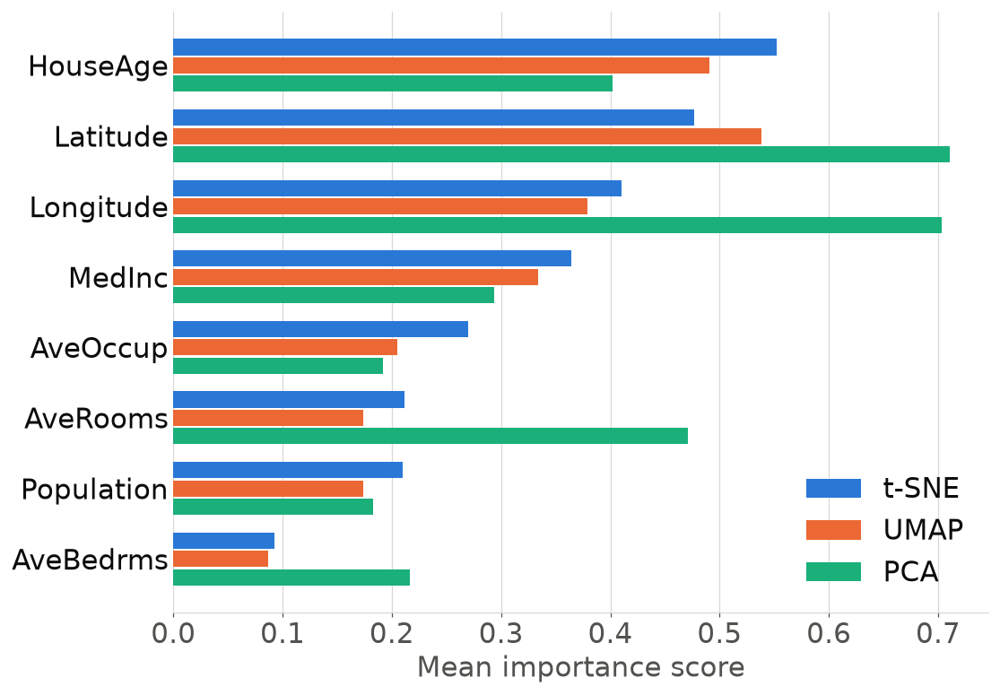{width="100%" fig-align="center"}
:::
::::

::: {.notes}
This is the mean score per feature over all 2,000 districts, for each method.

t-SNE and UMAP rank the features almost the same way for each district: rank correlation
0.87. Against PCA it is about 0.71.

The visible difference is rooms. PCA gives it a lot of weight and the other two do not. A
few districts have extreme room counts, think resorts, and PCA stretches an axis to cover
them. t-SNE and UMAP care about neighbours, not extremes.

So FADEx is not only for explaining one layout. It is a way to see how projection methods
behave.
:::

## Can we trust the arrows? Test them

| Projection | Agreement with held-out neighbours | Chance level |
|---|---|---|
| PCA | 1.00 | 0.50 |
| t-SNE | 0.84 | 0.53 |
| UMAP | 0.85 | 0.51 |

: {tbl-colwidths="[30,45,25]"}

* Fit the local rule on 70% of a district's neighbours, then predict where the other 30% should be
* 1 means the predicted direction is exactly right; a layout unrelated to the data scores about 0.5 here, not 0
* A low value says the layout is too rough there for a straight-line explanation

::: {.notes}
The measure is cosine similarity between the predicted and the actual displacement,
averaged over 300 districts.

PCA is exactly linear, so the score is 1. For t-SNE and UMAP, 0.84 and 0.85 mean the local
rule predicts directions well.

Compare with the chance column, not with zero. Chance level is the same test on a layout
whose rows have been shuffled, so it has nothing to do with the data. It still scores about
0.5, because a district's neighbours tend to lie on one side of it, toward the bulk of the
data, in both spaces, and a straight-line rule picks that up. In the package this is
fit_quality with baseline switched on.

Why direction and not an error in layout units: the layout has no physical scale, and
direction is what the arrows and the scores use. What it does not test is magnitude, so it
says nothing about the stretch map.

This tests the local rule, not the scores. The next two slides test the scores.

This test costs nothing extra and I would run it every time. It is how you find out that a
projection is too jumpy for this kind of explanation.
:::

## Can we trust the scores? Plant the answer

:::: {.columns}
::: {.column width="46%"}
* 2,000 made-up points with 12 features, each a random number between 0 and 1
* Three groups, each made by shifting **four features we choose** and leaving the other eight alone
* So for every point we know which features set it apart
* FADEx is given only the data and a UMAP layout
:::
::: {.column width="54%"}
Average value of the features, by group:

| Group | Points | Features 0–3 | Features 4–7 | Features 8–11 |
|---|---|---|---|---|
| C0 | 250 | **2.5** | 0.5 | 0.5 |
| C1 | 500 | 0.5 | **2.5** | 0.5 |
| C2 | 1,250 | 0.5 | 0.5 | **−1.5** |

: {tbl-colwidths="[14,14,24,24,24]"}
:::
::::

::: {.notes}
The hold-out test checks the local rule. It does not check that the scores pick the right
features. For that we need a case where the right features are known.

This is the synthetic test from the paper (its Fig. 3). Every feature starts as a uniform
number between 0 and 1. Group C0 gets about plus 2 added to features 0 to 3, C1 to features
4 to 7, and C2 gets about minus 2 on features 8 to 11. The shift is noisy, with a spread
of 1, so the groups overlap a little.

The table shows the group averages: 2.5 where a group was shifted up, minus 1.5 where it
was shifted down, 0.5 everywhere else.

FADEx is not told the groups or which features were shifted.
:::

## The scores recover the features we planted

**Each group scores high on exactly the four features we shifted.**

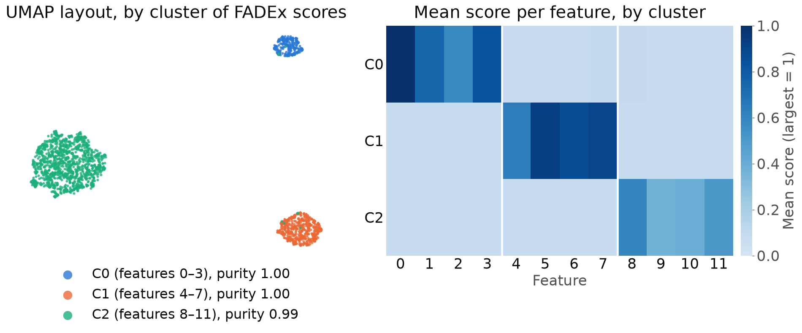{fig-align="center"}

::: {.notes}
Left: the UMAP layout. The colours come from grouping points by their score vectors alone,
with no labels and no positions. They match the three blobs: purity 1.00, 1.00 and 0.99.
Points built the same way get the same explanation.

Right: the mean score of each feature within each group. The dark squares run down the
diagonal: the first group scores high only on features 0 to 3, the second only on 4 to 7,
the third only on 8 to 11. Those are the features we shifted.

If asked why scores inside a block are unequal: the shift is noisy, so the groups partly
overlap.

If asked why the C2 block is paler (my reading, not in the paper): the score multiplies by
the feature's own value, and C2's shifted values, around minus 1.5, are closer to zero than
those of C0 and C1, around 2.5.

This is our rerun of the paper's figure; the paper reports purity 1.00, 1.00 and 0.94.
:::

## FADEx in relation to other explanation methods

::: {style="font-size: 0.9em;"}
| Method | Attribution | Works with any projection | Speed | Distortion | Needs to place new points |
|---|---|---|---|---|---|
| DimReader | Gradient-based | Limited | Slow | No | No |
| FeatureClock | One per feature | Yes | Medium | No | No |
| ClusterShapley | One per feature | Yes | Medium | No | Yes |
| LXDR | Several per feature | Limited | Fast | No | Yes |
| Corbugy et al. | Several per feature | t-SNE only | Fast | No | No |
| **FADEx** | **One per feature** | **Yes** | **Faster** | **Yes** | **No** |

: {tbl-colwidths="[16,20,20,11,13,20]"}
:::

::: {.notes}
Table 1 of the paper. FADEx builds on a line of earlier work; name the methods and what
each contributed before pointing at the last row.

DimReader: gradient-based, only partly independent of the projection method, slow.
FeatureClock: one score per feature and works with any projection, but it fits several
linear models per point. ClusterShapley: built on KernelSHAP, explains how clusters form,
needs to place new points. LXDR: one local linear model per layout axis, hence two numbers
per feature; needs to place new points. Corbugy: uses the derivatives of the t-SNE loss,
so it is t-SNE only.

Three distinctions matter here. One number per feature instead of one per axis. No need to
place new points. And none of the other attribution methods in the table reports where the
layout is stretched.

The speed labels follow the paper's table. Its timing benchmark covers LXDR,
ClusterShapley and Corbugy, not DimReader or FeatureClock.
:::

## Running it takes a few lines

::: {style="font-size: 1.45em;"}
```python
from sklearn.manifold import TSNE
from sklearn.preprocessing import StandardScaler
from fadex import FADEx

X = StandardScaler().fit_transform(data)               # the eight features
Y = TSNE(n_components=2, perplexity=50).fit_transform(X)    # any projection

fx = FADEx(high_dim_data=X, low_dim_data=Y,
           n_neighbors=200, feature_names=names)

fx.fit(explain_index=0)                    # which: scores for one district
fx.plot_grid_feature_vectors("Latitude")   # how: arrows for one feature
fx.plot_distortion()                       # where: the stretch map
```
:::

`pip install fadex-exp` · one Python file · NumPy, scikit-learn, pandas, Matplotlib, Plotly · MIT licence · all 2,000 districts explained in under 0.2 s on a laptop

::: {.notes}
The inputs are the data and the layout. Nothing about t-SNE is passed in, so swapping in
UMAP changes one line.

A neighbourhood of about 10 percent of the data is a good starting point; here 200 of
2,000.

Implementation. The package is a single file of about 1,200 lines, most of it plotting;
the fit and the score are about 50 lines of NumPy. Per point the work is one
nearest-neighbour query, one small linear system and one small matrix decomposition. No
GPU. The install also brings SciPy and tqdm.

Speed: 0.16 to 0.18 seconds for all 2,000 districts on an Apple M5 laptop, with the
current repository version. High-dimensional data costs more: the paper reports 0.46
seconds per explained point on 5,000 MNIST digits with 784 features.

The hold-out test from two slides back is fit_quality in the repository. Check it is in
the released version before recommending it.
:::

## What to remember

* A projection shows groups, but not what they mean or how far to trust them
* FADEx fits a small straight-line rule around every point, using only the data and the layout
* It answers **which** features place a point, **how** each feature would move it, and **where** the layout is stretched
* Two tests back it up: the local rule predicts held-out neighbours, and the scores recover features planted in synthetic data
* **Keep in mind:** arrows are predictions of the local rule, scores depend on how features are scaled, stretch is relative, and rough layouts need the hold-out test

::: {.notes}
On the cautions.

Arrows: an arrow says what the fitted local rule predicts for a small change. It is not a
rerun of the projection with a changed point.

Scaling: the score uses the feature's value, so standardize first and remember that a
district with an average value gets a low score for that feature.

Stretch: compare regions within a layout; do not read the absolute number.

Roughness: the method assumes the layout is smooth around each point. The hold-out test
tells you when that is true.
:::

## Acknowledgments

:::: {.columns}
::: {.column width="68%"}
Joint work with **Lucas Greff Meneses**, **Evandro S. Ortigossa** and **Luis Gustavo Nonato**

*FADEx: Feature Attribution and Distortion-based Explanation of Dimensionality Reduction*, to appear in IEEE Transactions on Visualization and Computer Graphics · [arXiv:2607.27463](https://arxiv.org/abs/2607.27463)

::: {style="font-size: 1.5em; line-height: 1.5; margin-top: 0.6em;"}
**Questions?**

csilva@nyu.edu

[github.com/greffao/fadex](https://github.com/greffao/fadex)
:::
:::
::: {.column width="32%"}
{width="430" fig-align="center"}
:::
::::

::: {style="font-size: 0.75em; margin-top: 1.2em;"}
Supported by **FAPESP** (grants 2022/09091-8, 2025/10383-1 and 2025/18911-7), **CNPq** (grant 307184/2021-8), the **Paulo Pinheiro de Andrade Fellowship**, **NSF** (grant OAC-2411221) and the **DARPA** expMath program.
:::

::: {.notes}
Closing slide: leave it up during questions. The QR code opens the GitHub repository.

Lucas Greff Meneses is the first author of the paper. Funding is taken from the
Acknowledgments section of the paper.
:::
