## A projection shows structure, but not why

::: {.prov}
Additional example
:::

**California Housing: 2,000 districts, 8 features including latitude and longitude, t-SNE. What are the two groups?**

:::: {.columns}
::: {.column width="56%"}
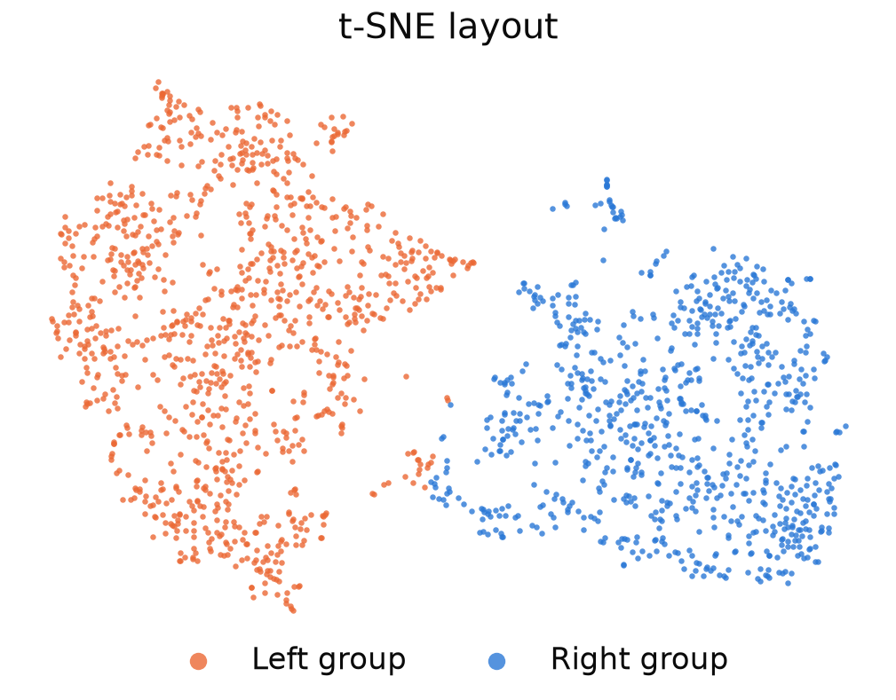{height="640" fig-align="center"}
:::
::: {.column width="44%"}
::: {.fragment}
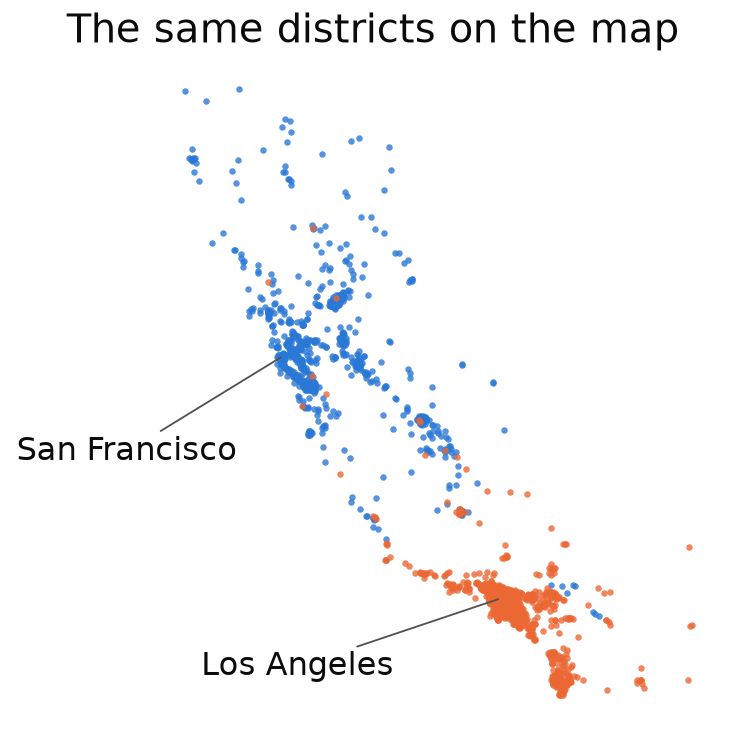{height="640" fig-align="center"}
:::
:::
::::

::: {.fragment}
The split follows geography. But the layout alone does not say **which features** put each district where it is.
:::

::: {.notes}
This example is not in the paper. It is a dataset anyone can load from scikit-learn, and
one where the audience can check the answer.

Each dot is a census district. Say the eight features aloud, because latitude and longitude
are among them: median income, house age, rooms,
bedrooms, population, occupancy, latitude and longitude. All standardized, t-SNE with
perplexity 50.

t-SNE, UMAP and other nonlinear methods are opaque: they return positions and nothing else.

CLICK. The same districts on the map, same colours. The left group is Los Angeles and San
Diego, the right group is the Bay Area, Sacramento and the Central Valley. Splitting at 36
degrees north reproduces the grouping for 97 percent of districts.

CLICK. Here we could find that out because we know California, and because latitude and
longitude are inputs. Which features explain one particular district's position is still
not visible. In general the layout does
not tell us which features drive it, how it would change if a feature changed, or whether
the distances we see can be trusted. Those are the three questions of this talk.

If asked "colouring by latitude shows this too": yes, here. That is one picture per
feature and only shows global patterns. FADEx gives a ranking for each point.
:::

## PCA is the easy case: every feature has one arrow

::: {.prov}
Additional example
:::

:::: {.columns}
::: {.column width="40%"}
* The same districts with PCA: each axis is a fixed blend of the eight features
* So each feature pushes every district in one fixed direction: raise Latitude and a district moves right and down, wherever it starts
* t-SNE and UMAP often separate groups more visibly, but come with no arrows
* **Goal:** this kind of explanation for any projection
:::
::: {.column width="60%"}
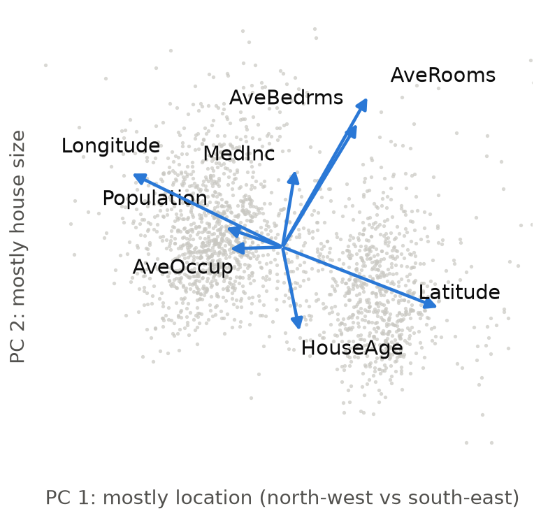{height="760" fig-align="center"}
:::
::::

::: {.notes}
This is a biplot, and it is why PCA is considered interpretable. The arrows are the
explanation: one arrow per feature for the whole picture, and a long arrow means the
picture responds strongly to that feature.

Read it: Latitude and Longitude point in opposite directions, because California runs from
north-west to south-east, so going north means going west.

PCA pays for this simplicity: these two axes keep only about half of the variation in the
data, 49 percent. That is why people use t-SNE and UMAP, and those give no table of weights
to read arrows from.

FADEx gives arrows for any projection. They can no longer be the same everywhere, so there
is one set per point.

Visibly separated groups are not the same as a more faithful picture; that is one reason
to ask where the layout is stretched.

We come back to this picture: Check 2 shows that FADEx, applied to this PCA
layout without being told it is PCA, recovers these arrows to within 0.01.
:::

## FADEx gives three explanations from one model

::: {.prov}
Additional example
:::

:::: {.columns}
::: {.column width="33%"}
**Which** features matter: one score per feature, per point

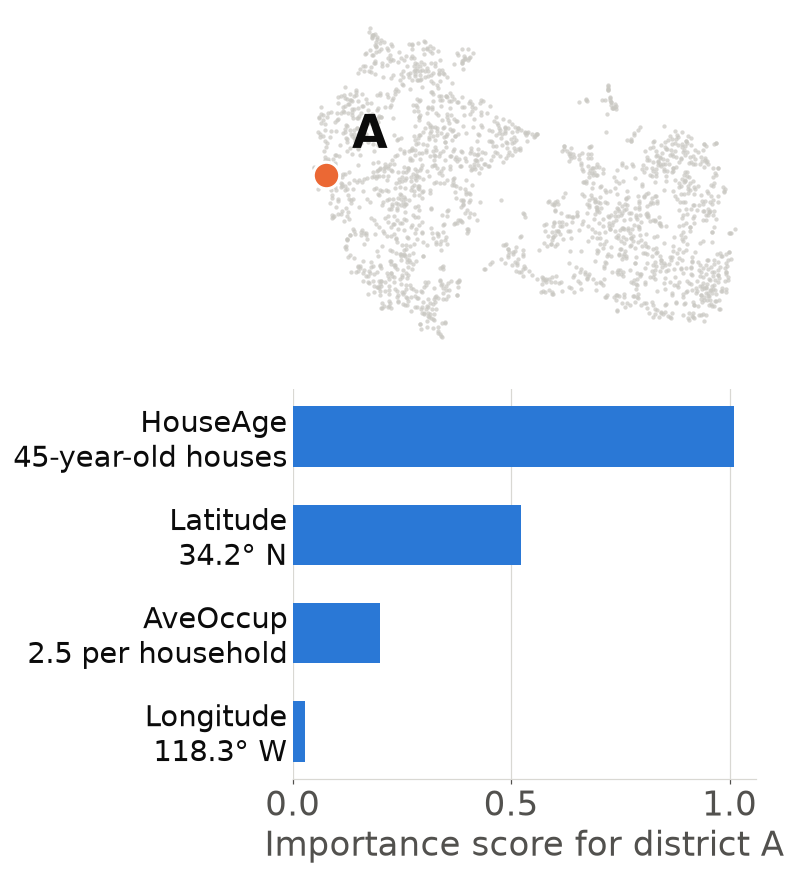{height="700" fig-align="center"}
:::
::: {.column width="33%"}
**How** they act: the direction the local model predicts when a feature increases

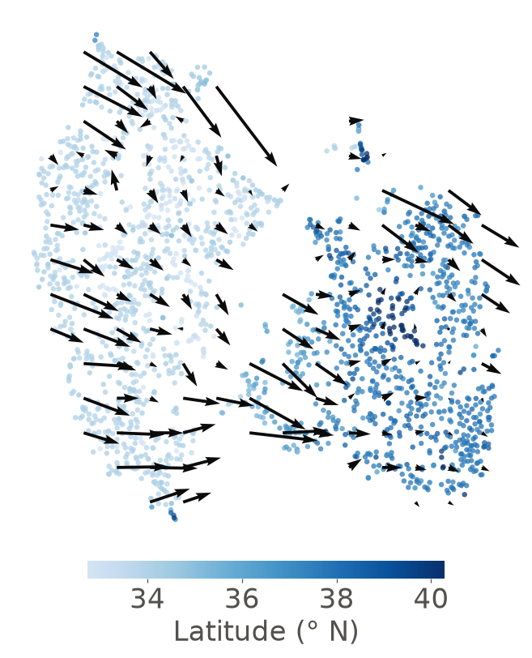{height="700" fig-align="center"}
:::
::: {.column width="33%"}
**Where** it is stretched: the largest local stretch, relative to the median

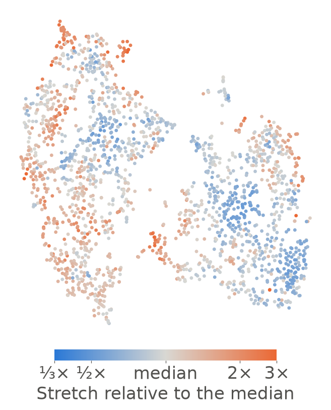{height="700" fig-align="center"}
:::
::::

::: {.notes}
Input: the data and its 2-D layout, nothing else. Output: three explanations for every
point. All three panels are the California layout from the previous slide.

Left: district A is in the Los Angeles area. Its houses are 45 years old, against a typical
29, and house age gets the top score, then latitude. Another district gets another ranking.

Middle: the arrows for Latitude. Almost all of them point from the southern group to the
northern one: the fitted local model predicts that a small increase in latitude moves a
district toward Northern California. That is the geography from the previous slide. It is
a prediction of the local model, not a rerun of t-SNE.

Right: orange marks neighbourhoods with a larger estimated maximum stretch than the median,
blue a smaller one. The scale is relative, because the absolute value depends on units. A
low value does not by itself mean the neighbourhood is shown faithfully.

The rest of the talk: how these are computed, then the paper's results.
:::

## FADEx in relation to prior work

::: {.prov}
Paper, Table 1
:::

| Method | Attribution | DR-agnostic | Speed | Distortion | Needs out-of-sample |
|---|---|---|---|---|---|
| DimReader | Gradient-based | Limited | Slow | No | No |
| FeatureClock | Single per feature | Yes | Medium | No | No |
| ClusterShapley | Single per feature | Yes | Medium | No | Yes |
| LXDR | Multiple per feature | Limited | Fast | No | Yes |
| Corbugy et al. | Multiple per feature | t-SNE only | Fast | No | No |
| **FADEx** | **Single per feature** | **Yes** | **Faster** | **Yes** | **No** |

: {tbl-colwidths="[17,23,15,12,13,20]"}

::: {.notes}
Name the earlier methods and what each contributed first (one line each, below). Do not
read every cell. Then three distinctions.

Out-of-sample: perturbation methods need an interface that places new points in an existing
layout. Standard t-SNE has none. FADEx does not need one.

Multiple attributions: surrogate methods give one weight per layout axis, so two numbers
per feature. FADEx gives one.

Distortion: none of the attribution methods in this table reports it.

"Faster" means time per explained instance. The speed labels follow Table 1 of the paper.
The benchmark in backup covers LXDR, ClusterShapley and Corbugy; it does not include
DimReader or FeatureClock.

One line per method, if asked. DimReader: gradient-based, only partly agnostic, slow.
FeatureClock: one score per feature and agnostic, but it fits several linear models per
instance, and has no distortion measure. ClusterShapley: built on KernelSHAP, explains
cluster formation, needs out-of-sample mapping. LXDR: one local linear surrogate per layout
axis, hence two numbers per feature; needs out-of-sample mapping. Corbugy: analytical
derivatives of the t-SNE loss, so t-SNE only.
:::

## The idea of FADEx: a set of arrows at every point

::: {.prov}
Additional example
:::

:::: {.columns}
::: {.column width="40%"}
* A curved mapping looks straight if you zoom in far enough
* So around each point, FADEx fits a small linear model, like PCA's, valid only nearby
* The result is a local set of arrows, one per feature, that changes from place to place
:::
::: {.column width="60%"}
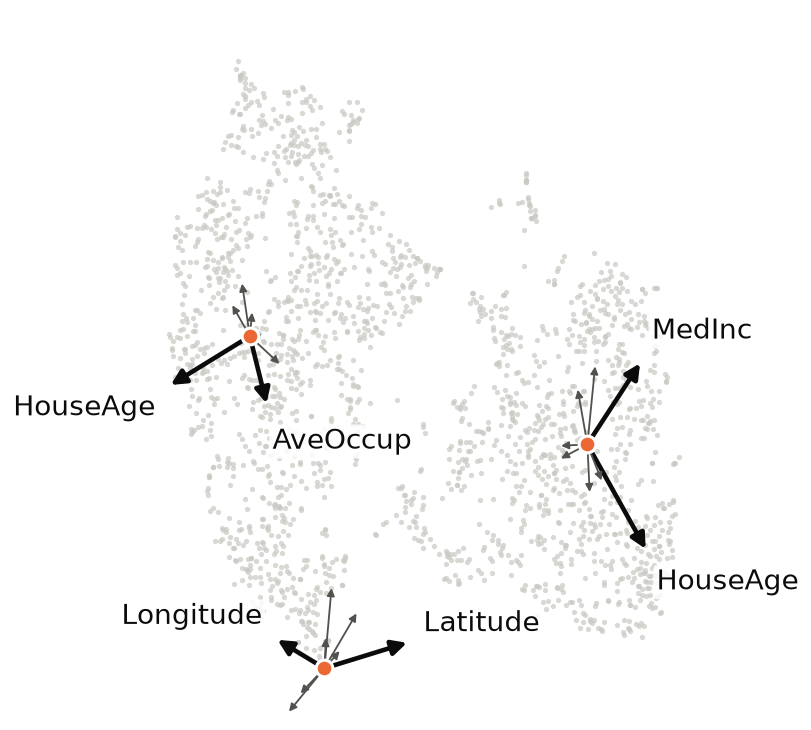{height="760" fig-align="center"}
:::
::::

::: {.notes}
Three California districts, each with its own eight arrows. The two longest are labelled.

In the bottom district, Latitude and Longitude are the long arrows. In the one on the
right, it is income and house age.

For PCA this picture is the biplot: one set of arrows, the same everywhere. For t-SNE the
arrows differ from point to point, and that is exactly what makes it hard to read.
:::

## How FADEx works, 1: the key step is estimating the Jacobian

Near a point $\mathbf{x}$, approximate the DR mapping $\mathcal{M}$ by a linear rule: $\;\mathcal{M}(\mathbf{x}+\mathbf{h}) \approx \mathcal{M}(\mathbf{x}) + J\,\mathbf{h}$. t-SNE and UMAP give no formula for the Jacobian $J$, so FADEx fits it from the points already in the layout:

1. Take the $k$ nearest neighbours $\mathbf{x}_\ell$ of the point $\mathbf{x}$ in the data space
2. Look at where the projection placed them, $\mathbf{y}_\ell$
3. Fit the $J$ that best turns differences in features into differences in position, with nearer neighbours counting more:

$$\min_J \;\sum_{\ell=1}^{k} w_\ell\,\bigl\|(\mathbf{y}_\ell-\mathbf{y}) - J\,(\mathbf{x}_\ell-\mathbf{x})\bigr\|^2 \;+\; \alpha\,\|J\|^2 \qquad\quad w_\ell = e^{-r_\ell^2/2\sigma^2}$$

It uses only the data and the finished layout: **no out-of-sample interface needed, any DR method**.

::: {.notes}
M is the DR technique itself, t-SNE here, seen as a function: it takes a district's eight
features and returns its position in the layout. We have no formula for M. We only see
where it put each point.

We approximate M near one point x by a linear map, a first-order Taylor expansion: change
the features by a small h, and the position changes by J times h. The approximation is
local. It holds for small h around this x, and every point gets its own J.

Everything on the next two slides is read from J, so estimating J well is the core of the
method.

Step 3 is a weighted ridge least-squares fit. r is the distance from x to the neighbour,
sigma is the median of those distances, and alpha is 0.1 by default; it keeps the system
stable when the neighbourhood is unevenly sampled. It has a closed-form solution, one small
linear system per point.

This is also what makes the method agnostic. We never ask the DR method to place a new
point. Standard t-SNE has no interface for that (some implementations, such as openTSNE,
add one). We only look at where it already put the neighbours.

In high dimensions we first drop locally constant features and apply a local PCA keeping
95 percent of the variance, then map the Jacobian back with the chain rule.

If asked whether this is a surrogate method like LIME: it is a local linear approximation,
so the word fits. The difference is operational: we fit it to existing neighbours, without
generating or projecting additional samples.
:::

## How FADEx works, 2: the local rule is a table of numbers

::: {.prov}
Additional example
:::

The fitted $J$ has 2 rows, one per layout axis, and one column per feature. For district A:

::: {style="font-size: 0.8em;"}
| | MedInc | HouseAge | AveRooms | AveBedrms | Population | AveOccup | Latitude | Longitude |
|---|---|---|---|---|---|---|---|---|
| horizontal | −5.2 | −11.5 | −4.3 | −1.9 | −2.0 | 1.8 | **13.0** | −0.4 |
| vertical | 10.5 | −0.9 | 5.9 | −2.4 | −2.3 | −4.7 | **−3.5** | 0.6 |

: {tbl-colwidths="[12,11,11,11,11,11,11,11,11]"}
:::

**How:** column $j$ is the influence vector of feature $j$, $\;g_j(\mathbf{x})$: the direction the local rule predicts for a small increase in that feature.

Latitude: 13.0 to the right and 3.5 down per unit. That is district A's Latitude arrow.

::: {.notes}
This is the J from the previous slide, fitted for district A: how much each layout
coordinate changes when each feature changes.

Read one column, Latitude, and skip the rest. It is a local rate of change: 13 layout units
to the right and 3.5 down per standard deviation of latitude. Features are standardized, so
the unit is one standard deviation. That is for reading the units. The linear rule is only
trusted for small changes, not for a full standard deviation.

It is a prediction of the fitted rule, not a rerun of t-SNE with a changed district. And
when features are correlated, read a single column with care.

These columns are the arrows from the "idea" slide, as numbers.

District A is the Los Angeles district from the "which" panel earlier.
:::

## How FADEx works, 3: reading scores and stretch from J

::: {.prov}
Additional example
:::

:::: {.columns}
::: {.column width="60%"}
Decompose it: $J_{\mathcal{M}}(\mathbf{x}) = U\,\Sigma\,V^{\top}$

* $J$ turns a small ball around the point into an ellipse in the layout
* Two directions in feature space, $\mathbf{v}_1$ and $\mathbf{v}_2$, become its axes, of lengths $\lambda_1 \ge \lambda_2$
* **Where:** the maximum local stretch is the long axis, $\;\mathrm{SND}(\mathbf{x}) = \lambda_1$
* **Which:** the score of feature $j$ is its share of those two directions, times the point's own standardized value $x_j$:

$$\phi_j \;=\; \bigl|v_{1j}\,x_j\bigr| \;+\; \frac{\lambda_2}{\lambda_1}\,\bigl|v_{2j}\,x_j\bigr|$$
:::
::: {.column width="40%"}
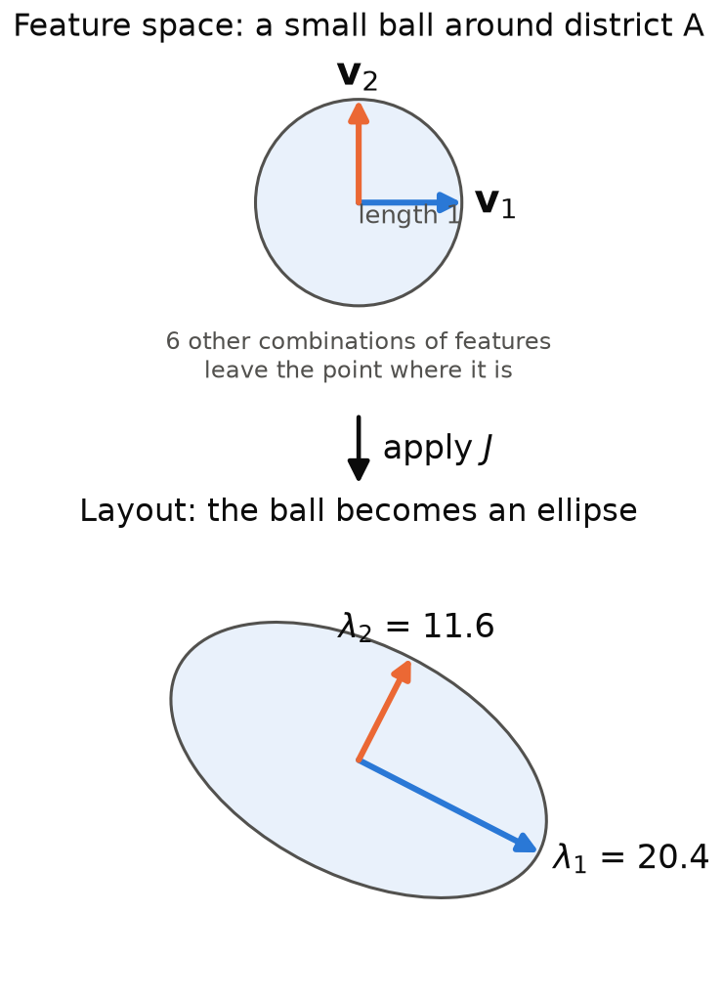{height="800" fig-align="center"}
:::
::::

**A feature scores high only when the layout is sensitive to it here *and* the point is unusual on it.**

::: {.notes}
The picture uses district A's real numbers. The ball is every district that differs from A
by one standard deviation in total. The local model sends it to the ellipse: 20.4 layout
units along the long axis, 11.6 along the short one.

V holds the two directions in feature space that the layout can see near this point. Moving
along anything perpendicular to both changes nothing in the layout.

Explain the picture before the formula.

SND is the spectral norm of J, the largest local stretch. It is one number for the long
axis only. It says nothing about the short axis.

Score: feature j's share of the strongest direction, plus its share of the second,
down-weighted by the ratio of singular values. One number per feature.

The bottom line, with district A. Income has a long arrow here, but A's income is average,
so its score is near zero. House age has a long arrow and A's houses are much older than
average, so it scores highest. The score is not the arrow length.

The features are standardized, so x_j is the distance from the average district. The
package by default measures x_j from the dataset mean; that equals the paper's formula on
centred data and differs on uncentred data. The backup slide works the score through for
district A.
:::

## Check 1, the fit: it predicts held-out neighbours

::: {.prov}
Rerun of paper Fig. 2
:::

**Fit on 70% of neighbours, predict the rest: directions agree in most settings; the test shows where they fail.**

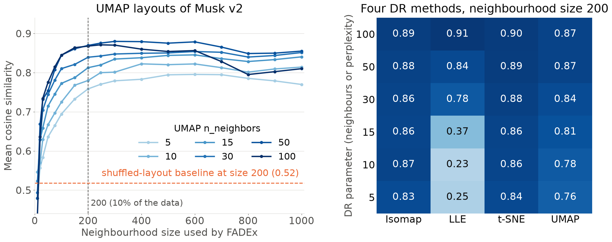{fig-align="center"}

::: {.notes}
Musk Version 2, 166 features, 2,000 samples.

This test evaluates the local approximation: does the fitted rule predict directions? It
does not test whether the scores pick the right features. Check 3, after the PCA
check, does that.

This figure is our rerun of Fig. 2 of the paper. The right panel uses a neighbourhood of
200, which is 10 percent of the sample; the paper's uses 247. The values still agree with
the paper's to within 0.03 on average.

Left, UMAP: similarity against neighbourhood size. A neighbourhood of about 10 percent of
the dataset works well; the dashed vertical line marks 200. The dashed orange line is a
baseline: the same test on a layout whose rows have been shuffled scores about 0.5, not 0.
It was computed at a neighbourhood size of 200 only and is drawn across the plot as a
guide, so it is not an exact chance level for the other sizes.

Right: four DR methods against their own neighbourhood parameter (perplexity for t-SNE).
Smoother layouts are easier to linearize. LLE with few neighbours is the hard case: 0.23 to
0.37 here (0.18 to 0.43 in the paper), which is at or below chance for 5 and 15 neighbours.
So the method assumes a
locally smooth layout, and this test tells you when that holds.

Why cosine similarity. The layout has no physical scale, so an absolute error would not
mean anything and could not be compared across methods or datasets. Direction is also what
the explanations use: an influence vector is read as a direction, and the score depends on
the two directions and the ratio of the singular values, not on the overall scale.

What it does not test: magnitude. SND is a magnitude, so this test does not validate it.
The supplement adds a second metric, the correlation of displacement magnitudes, and SND is
checked separately against the distance ratio (Table 2 of the paper).

If asked how to choose the neighbourhood size: about 10 percent of the data is a good
start. Strongly curved layouts need fewer: on a Swiss roll the fit is best at 10 to 50
neighbours.

For the California layout from the opening, the same test gives 0.84.
:::

## Check 2, the fit: on PCA, it recovers PCA's own arrows

::: {.prov}
Additional example
:::

**Where we know the answer, FADEx finds it. On t-SNE, the same feature gets a different arrow in each region.**

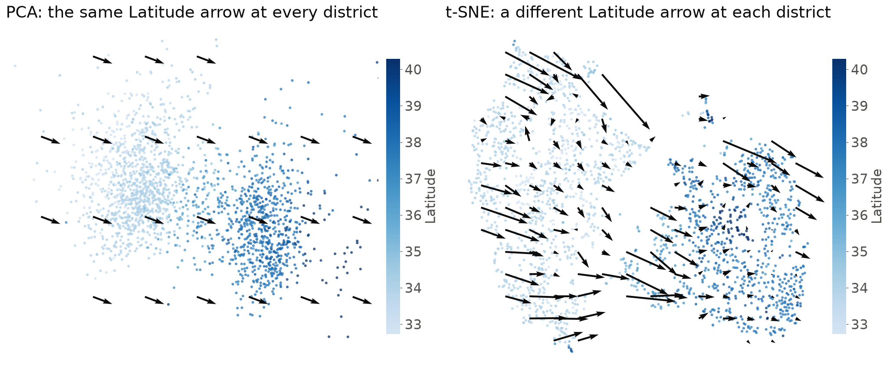{fig-align="center"}

::: {.notes}
Not in the paper. Same California data as the opening.

Left: FADEx applied to the PCA layout, arrows for Latitude. All parallel, all the same
length, and they match the true PCA arrow from the biplot to within 0.01. FADEx was not
told this was PCA.

Right: the same thing on t-SNE. The arrows mostly point from the southern group toward the
northern one, but direction and length vary.

Each arrow is the average over the districts in a grid cell.

On PCA the hold-out cosine similarity from the previous slide is 1.00, because the mapping
is exactly linear.

This is still a test of the fit. The next slide tests the scores.
:::

## Check 3, the scores: they recover features we planted

::: {.prov}
Rerun of paper Fig. 3
:::

**12 features, 3 clusters, each shifted in 4 known features: the block diagonal matches the ground truth.**

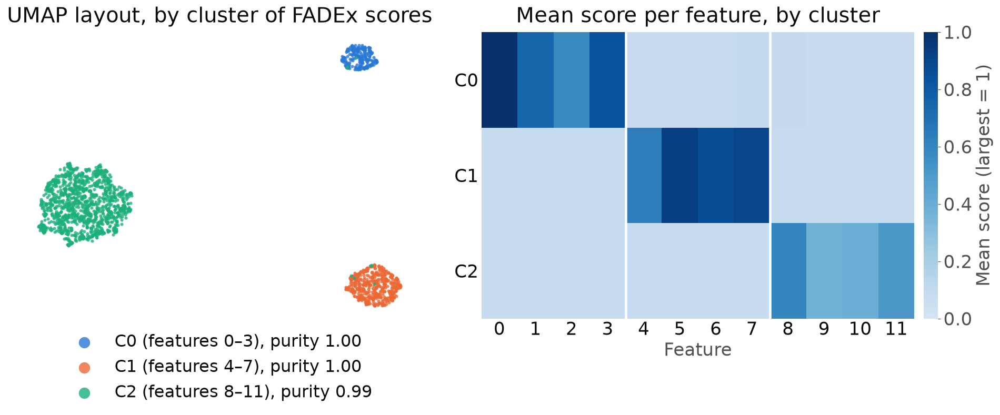{fig-align="center"}

::: {.notes}
SAY: "The last two slides tested the fit. This one tests the scores. We built data where we
know the answer: three clusters, each made by shifting four features we chose. FADEx sees
only the data and the layout. On the right, the scores it gives each cluster light up
exactly the four features we shifted, and nothing else. On the left, grouping points by
their scores alone recovers the three clusters."

The question: do the features with high scores actually matter? The previous two slides
tested only the local fit, which says nothing about whether the scores pick the right features.

"Planted" means we built the answer in. Each cluster differs from the rest only in four
features we chose, so for every point we know which features set it apart. FADEx was not
told the clusters or which features were shifted.

Left: the UMAP layout. The colours come from grouping points by their score vectors alone,
with no labels and no positions. They match the three blobs: purity 1.00, 1.00 and 0.99 in
this run; the paper reports 1.00, 1.00 and 0.94. Points built the same way get the same
explanation.

Right: the mean score of each feature within each group. The dark squares run down the
diagonal: the first group scores high only on features 0 to 3, the second only on 4 to 7,
the third only on 8 to 11. Those are the features we shifted.

Our rerun of Fig. 3 of the paper.

The setup. 2,000 points, 12 features, uniform between 0 and 1. Three clusters of 250, 500
and 1,250 points, each made by shifting four features by 2 with unit Gaussian noise: C0 in
features 0 to 3, C1 in 4 to 7, C2 in 8 to 11 (shifted downward). So we know which features
set each cluster apart. UMAP with 15 neighbours, FADEx on every point, then k-means with
k = 3 on the score vectors alone. No labels and no layout go into the clustering.

If asked why scores inside a block are unequal: with noise of 1 against a shift of 2, the
clusters still partly overlap.

If asked why the C2 block is paler (my reading, not in the paper): the score multiplies by
the feature's own value, and C2's shifted values, around minus 1.5, are closer to zero than
those of C0 and C1, around 2.5.

If asked about the neighbourhood: the paper says 20 neighbours, "10% of the data", but 20
of 2,000 is 1 percent. Both 20 and 200 recover the structure in our rerun.
:::

## SND on MNIST: it measures maximum local stretch

::: {.prov}
Rerun of paper Fig. 4
:::

:::: {.columns}
::: {.column width="40%"}
* SND is the largest local stretch of the fitted mapping, in layout units per data unit: compare values within one layout
* MNIST with t-SNE, panel B: SND at every point
* Panel C, the two extremes: the highest-SND point has its true neighbours scattered across the layout; the lowest keeps them together
:::
::: {.column width="60%"}
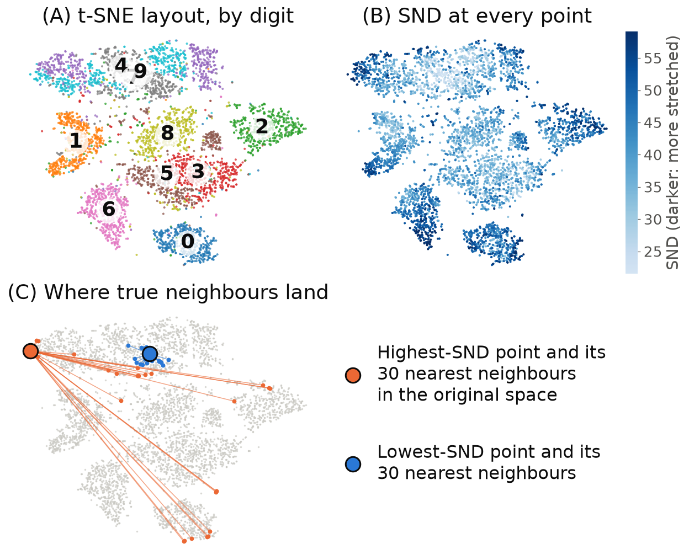{height="760" fig-align="center"}
:::
::::

::: {.notes}
5,000 MNIST digits, t-SNE. This figure is our rerun of Fig. 4 of the paper. In panel B,
darker blue means a larger SND; every point is above 1.

Panel C is the check: take the highest and the lowest SND point, find their nearest
neighbours in the original 784-dimensional space, and draw them in the layout. For the
high-SND point they land all over the map.

Quantitatively, SND correlates with the distance preservation ratio: 0.86 to 0.92 on Wine,
Breast Cancer, Dermatology and Dry Bean, lower on the very high-dimensional sets.

What SND is not: a full measure of distortion. A neighbourhood can be squeezed hard in one
direction and still have a moderate SND, so a low value does not establish that the
neighbourhood is faithful.

If asked what "1" means: SND compares layout units to data units, so the threshold depends
on how both are scaled. Read the map as relative unless you normalize.

The correlations above are the paper's. In our rerun the Dry Bean value depends on the
neighbourhood size: 0.90 with 300 neighbours, 0.20 with 10 percent of the data (t-SNE).

If asked how strong the relation is on MNIST: panel C shows the two extremes, and they are
clear. Over all 5,000 points the relation between SND and how far the true neighbours land
is weak in our rerun (rank correlation 0.06). Present panel C as an illustration.

If asked about Hypertrix: on this same setup Hypertrix marks the digit 1 cluster as highly
distorted and SND does not. The supplement (Sec. 3) traces this to three choices in
Hypertrix: a global PCA above 50 dimensions, no chain rule back to the original features,
and neighbours taken in the projected space.
:::

## Cats and dogs: one score per feature also works for images

::: {.prov}
Paper, Fig. 9
:::

**Cats and dogs under t-SNE: the top-scoring network features, drawn on each image, mark fences, faces and legs.**

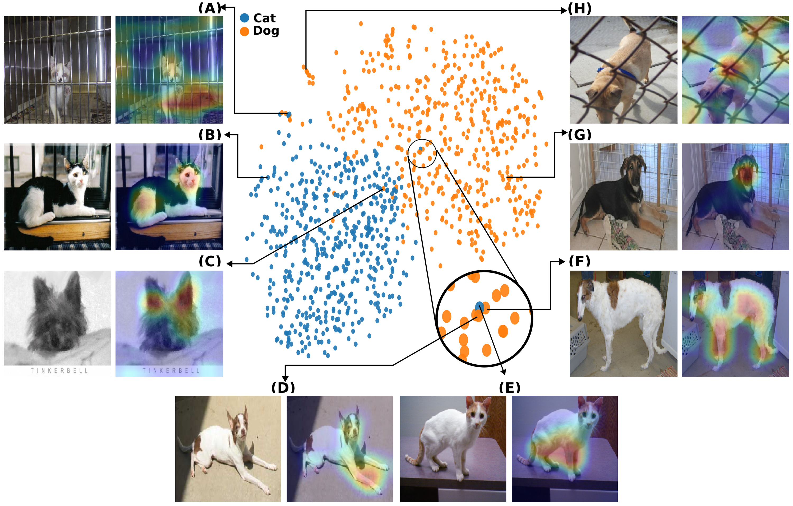{fig-align="center"}

::: {.notes}
Fig. 9 of the paper, in the extended version from the supplement. Not part of our rerun.

Pipeline: fine-tuned VGG16, last convolutional layer, 512 feature maps of 7 by 7, average
pooled to 512 features, t-SNE with perplexity 100. The top-10 FADEx features are upsampled
and overlaid as a heat map.

FADEx scores the 512 network features, not pixels. The heat map shows where the top ten
are active in the image. Present it as an interpretation supported by those features.

A and H: the small clusters at the top are images with wire fences. The fence features score
highest there, not the animal's, and cats and dogs mix.

D: a cat inside the dog group. The scores light up its legs. B is a nearby dog, also placed
by its legs. That is why they sit together.
:::

## Dry Bean, 1: same data, four DR methods, one explainer

::: {.prov}
Rerun of paper Fig. 8
:::

:::: {.columns}
::: {.column width="33%"}
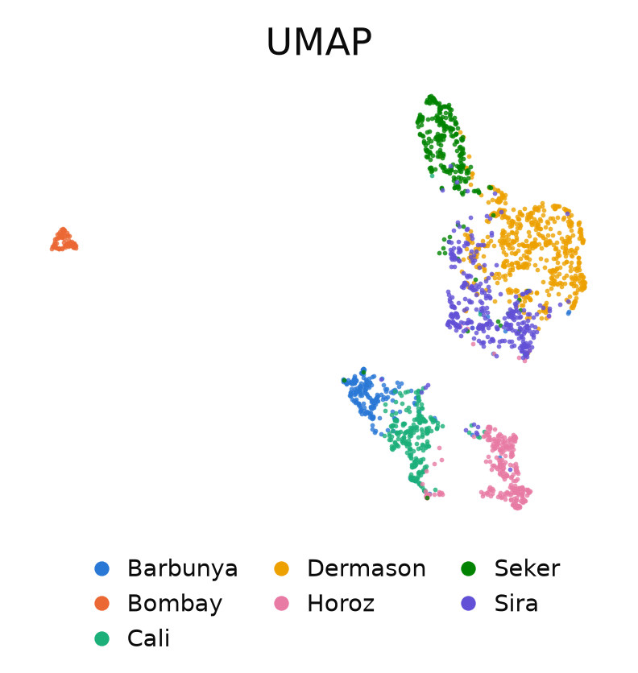{width="100%"}
:::
::: {.column width="33%"}
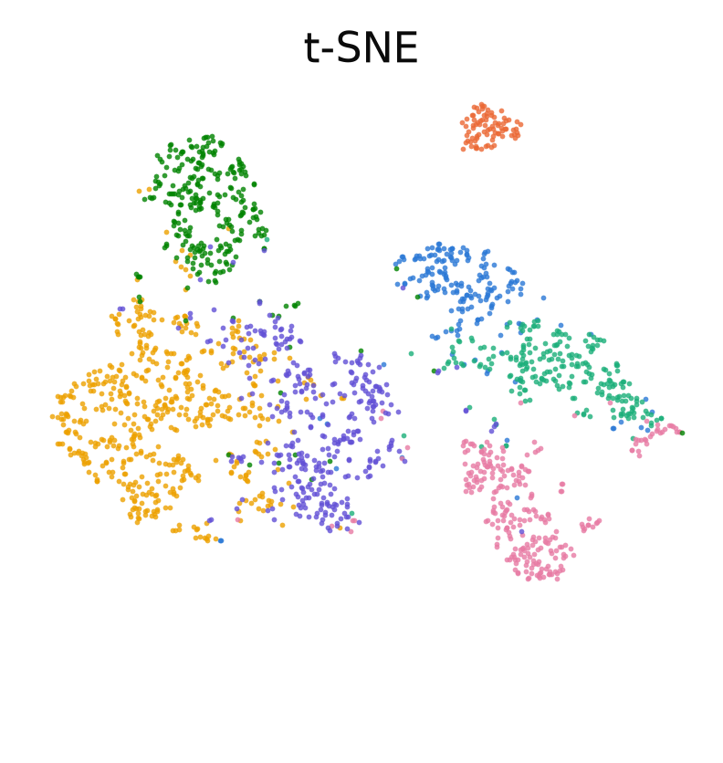{width="100%"}
:::
::: {.column width="33%"}
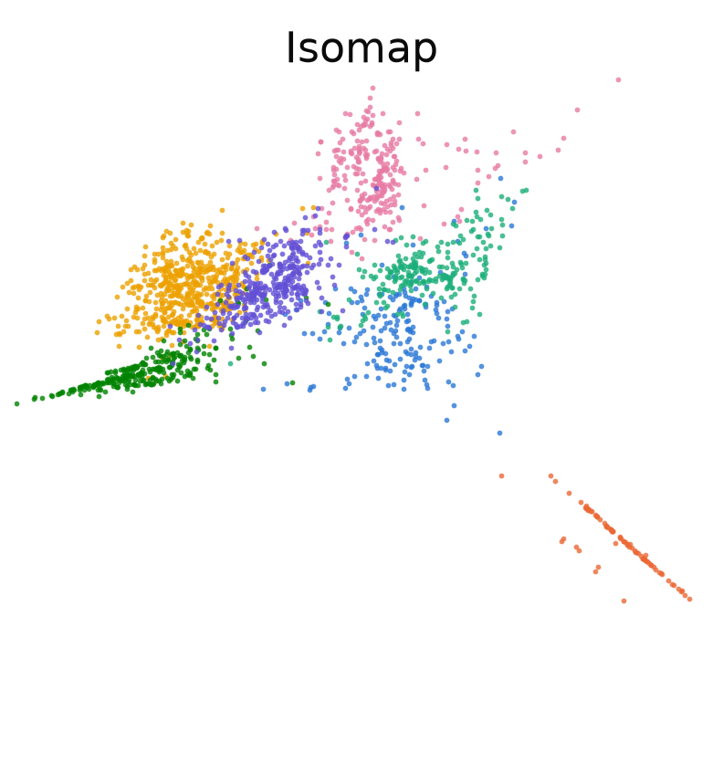{width="100%"}
:::
::::

* **Dry Bean:** 2,000 beans, 16 shape features, 7 classes
* Run FADEx on each layout: one score vector per bean, per method
* Pool the score vectors, with LLE's as a fourth set, and cluster them ($k = 3$)

::: {.notes}
Because FADEx only needs the data and the layout, the same code explains all of them.

Then we ask: do the four methods use the same features? We put all the score vectors in one
space and cluster them. All four methods spread over the three clusters in the same order:
most explanations in cluster 0, then cluster 1.

These layouts are our rerun of Fig. 8 of the paper, with default settings for each method.
The fourth method, LLE, is not pictured here: with its defaults it gives a thin, nearly
one-dimensional layout on this data. It is still part of the analysis and appears on the
next slide.

Spearman correlation between methods' score vectors runs from 0.65 (t-SNE and LLE) to 0.84
(t-SNE and UMAP) in the paper; in this rerun, from 0.60 (Isomap and LLE) to 0.89 (t-SNE and
UMAP).
:::

## Dry Bean, 2: they agree on what matters, not on how

::: {.prov}
Rerun of paper Fig. 8
:::

**ShapeFactor1 leads for all four methods; how its influence vectors vary across classes differs by method.**

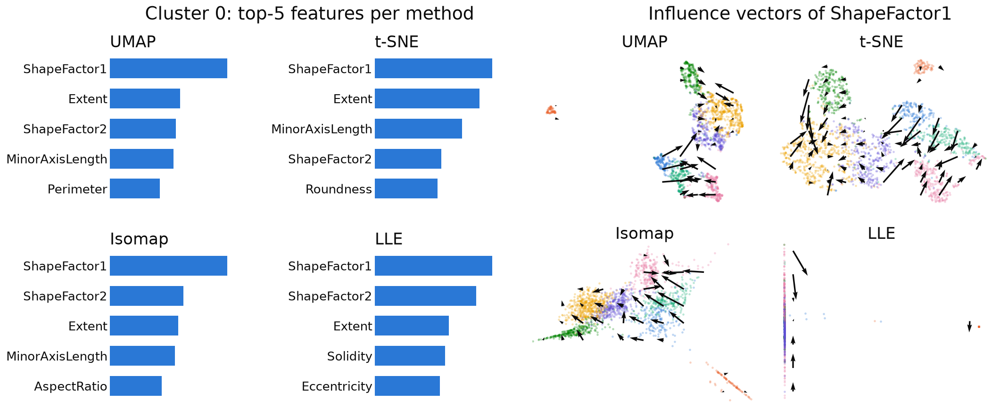{fig-align="center"}

::: {.notes}
Our rerun of Fig. 8 of the paper. Left: top-5 features for cluster 0, per method.
ShapeFactor1 is first everywhere, and ShapeFactor2 is in the top four everywhere. In the
paper's run ShapeFactor2 is second for all four; here Extent comes in ahead of it for UMAP
and t-SNE.

Right: influence vectors for ShapeFactor1. t-SNE: direction shifts from class to class,
longest in Barbunya and Cali, which point the same way. UMAP: similar, weaker. Isomap:
most classes point the same way, which fits its global nature. LLE: erratic, except for
the Bombay class.

Compare how the vectors vary within each layout, not their absolute direction or length
across layouts: each layout can be rotated or mirrored and has its own units. The shared
ranking on the left is the firmer result.

So the scores say the methods agree on which features matter. The vectors show each method
uses them differently.
:::

## Implementation: a small, open-source Python package

:::: {.columns}
::: {.column width="56%"}
::: {style="font-size: 1.35em;"}
```python
# pip install fadex-exp
from fadex import FADEx

fx = FADEx(high_dim_data=X,     # the data
           low_dim_data=Y,      # any finished layout
           n_neighbors=200,
           feature_names=names)

fx.fit(explain_index=0)                   # which
fx.plot_grid_feature_vectors("Latitude")  # how
fx.plot_distortion()                      # where
```
:::
:::
::: {.column width="44%"}
* **Use:** a few lines once you have a layout; nothing about the DR method is passed in
* **Size:** one Python file; the fit and the score are about 50 lines of NumPy
* **Dependencies:** NumPy, scikit-learn, pandas, Matplotlib and Plotly. No GPU
* **Speed:** all 2,000 California districts explained in under 0.2 s on a laptop
* **Licence:** MIT
:::
::::

::: {.notes}
The inputs are the data and the layout. Swapping t-SNE for UMAP changes nothing in this
code.

Size: the package is a single file of about 1,200 lines, most of it plotting. The method
itself is a weighted ridge solve and an SVD per point.

Dependencies: the install also lists SciPy and tqdm. No deep-learning framework.

Speed: 0.16 to 0.18 seconds for all 2,000 districts, 8 features, 200 neighbours, on an
Apple M5 laptop, with the current repository version. Per point the work is one
nearest-neighbour query, one small linear system and one SVD of a 2-by-n matrix. The
paper's benchmark, per explained instance: 0.02 s on Breast Cancer up to 0.46 s on 5,000
MNIST digits with 784 features. High-dimensional data costs more because of the local PCA.

The repository also has a fit_quality method that runs the hold-out test from earlier.
Check it is in the released version before recommending it.
:::

## Takeaways and future work

* One local linear model per point gives **scores**, **influence vectors** and a **distortion map**
* It needs only the **data** and the **layout**, so it works with any DR method
* One score per feature, at the lowest time and memory cost in our benchmarks
* **Limits:** it assumes a locally smooth layout, and in high dimensions it relies on local PCA

**Future work**

* Put these explanations inside interactive visualization tools
* Test whether DR methods agree on feature importance across more datasets, as t-SNE and UMAP did on Dry Bean
* Use DR explanations to interpret ML models: in the image study, the top features look like the ones the classifier uses

::: {.notes}
The limits are real. If the layout is not smooth around a point, a linear model is the wrong
tool there, and the hold-out test will show it. If local PCA cannot reduce the dimension
without distorting the neighbourhood, the Jacobian is less faithful.

Future work, all three from the paper.

Interactive tools: the direction named in the conclusion.

Agreement between methods: on Dry Bean the methods ranked features similarly, most of all
t-SNE and UMAP. Whether that holds on a wider range of datasets is an open question.

ML models: in the cats-and-dogs study the features FADEx highlights appear to align with
those the fine-tuned network uses for its decision. That needs further investigation
before we can claim it.
:::

## Acknowledgments

:::: {.columns}
::: {.column width="68%"}
::: {style="font-size: 1.7em; line-height: 1.5; margin-top: 0.4em;"}
**Questions?**

csilva@nyu.edu

[github.com/greffao/fadex](https://github.com/greffao/fadex)
:::
:::
::: {.column width="32%"}
{width="430" fig-align="center"}
:::
::::

**Summary:** Given a dataset and its layout, FADEx estimates **which** features matter locally, **how** they act, and **where** the layout is stretched.

::: {style="font-size: 0.75em; margin-top: 1.2em;"}
Supported by **FAPESP** (grants 2022/09091-8, 2025/10383-1 and 2025/18911-7), **CNPq** (grant 307184/2021-8), the **Paulo Pinheiro de Andrade Fellowship**, **NSF** (grant OAC-2411221) and the **DARPA** expMath program.
:::

::: {.notes}
Closing slide: leave it up during questions. The QR code opens the GitHub repository.
Install with pip install fadex-exp. Paper: arXiv 2607.27463.

Funding is taken from the Acknowledgments section of the paper. No need to read it out.

Backup slides follow: the worked score, rings, Breast Cancer, ablation, synthetic
validation, cost table, Dry Bean cluster 1.
:::

## Backup: the importance score, step by step

::: {.prov}
Additional example
:::

:::: {.columns}
::: {.column width="56%"}
::: {style="font-size: 0.8em;"}
| Feature | Weight in $\mathbf{v}_1$ | Weight in $\mathbf{v}_2$ | A's value $x_j$ | Score $\phi_j$ |
|---|---|---|---|---|
| MedInc | 0.46 | 0.61 | −0.02 | 0.02 |
| HouseAge | 0.48 | −0.52 | 1.30 | **1.01** |
| AveRooms | 0.32 | 0.29 | 0.02 | 0.01 |
| AveBedrms | 0.03 | −0.26 | −0.06 | 0.01 |
| Population | 0.04 | −0.26 | 0.13 | 0.02 |
| AveOccup | −0.18 | −0.29 | −0.58 | 0.20 |
| Latitude | −0.65 | 0.24 | −0.67 | **0.52** |
| Longitude | 0.03 | 0.03 | 0.61 | 0.03 |

: {tbl-colwidths="[24,19,19,19,19]"}
:::
:::
::: {.column width="44%"}
1. **Weights:** how much each feature takes part in the two directions the layout responds to
2. **Value:** how far district A is from the average district on that feature
3. **Score:** multiply them, and add the two directions, discounting the weaker one by $\lambda_2/\lambda_1 = 0.57$

HouseAge: $|0.48 \times 1.30| + 0.57\,|{-0.52} \times 1.30| = 1.01$
:::
::::

**A feature scores high only when the layout is sensitive to it here *and* the point is unusual on it.**

::: {.notes}
District A, all eight features. Values are standardized: zero is an average district.

Income has large weights in both directions, so the layout is very sensitive to income
here, but A's income is average, so the score is 0.02. Longitude is the opposite: A is well
off average, but the layout barely responds to longitude at this spot. House age and
Latitude are high on both counts.

So the score is not the arrow length: the "which" and "how" pictures can disagree.
:::

## Backup: influence vectors on data with a known shape

::: {.prov}
Paper, Fig. 6
:::

**Interlocked 3-D rings, t-SNE: arrows turn tangent to a ring where its points run along that axis.**

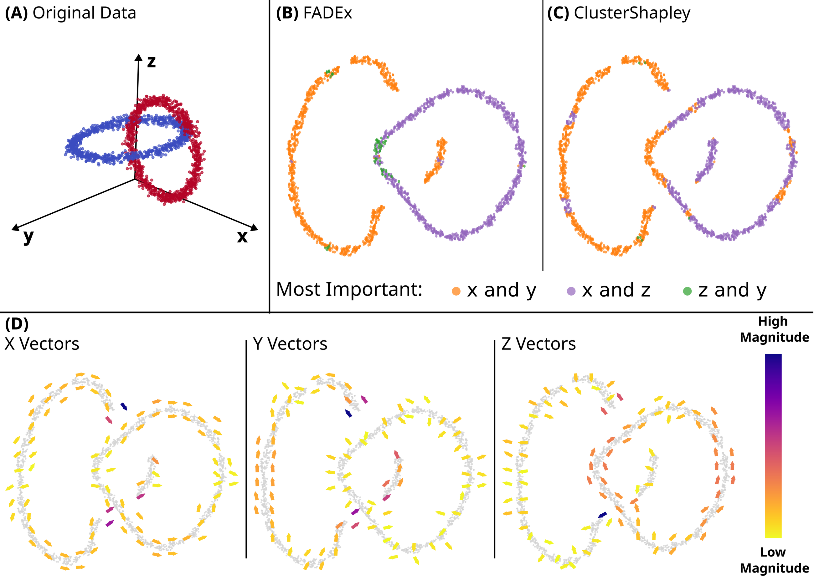{fig-align="center"}

::: {.notes}
Fig. 6 of the paper.

A is the data: a blue ring in the x-y plane, a red ring in the x-z plane.

B and C colour each point by its top two features. FADEx picks x and y on one ring and x and
z on the other. ClusterShapley swaps them in the centre and on the right.

D is the vector field per feature. Where vectors run along the curve, changing that feature
slides a point along the ring. Where they are perpendicular, it pushes the point off the
structure.

In our rerun, the top two features are the right pair for 98 percent of the points on each
ring.
:::

## Backup: Breast Cancer case study

::: {.prov}
Rerun of paper Fig. 7
:::

**UMAP, 569 samples, 30 features: at the class boundary, the area error vectors point toward the malignant group.**

:::: {.columns}
::: {.column width="50%"}
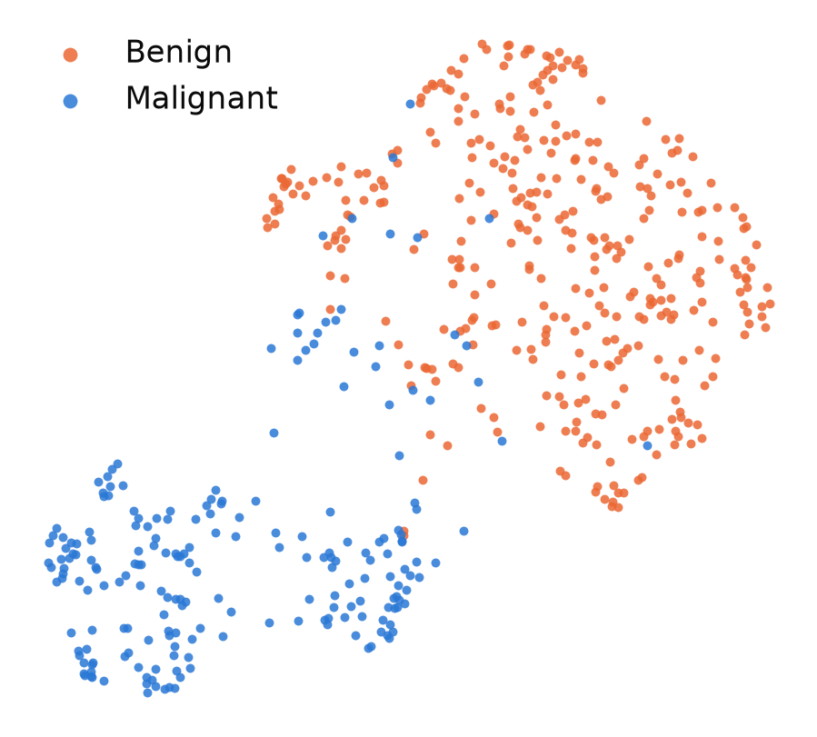{height="700" fig-align="center"}
:::
::: {.column width="50%"}
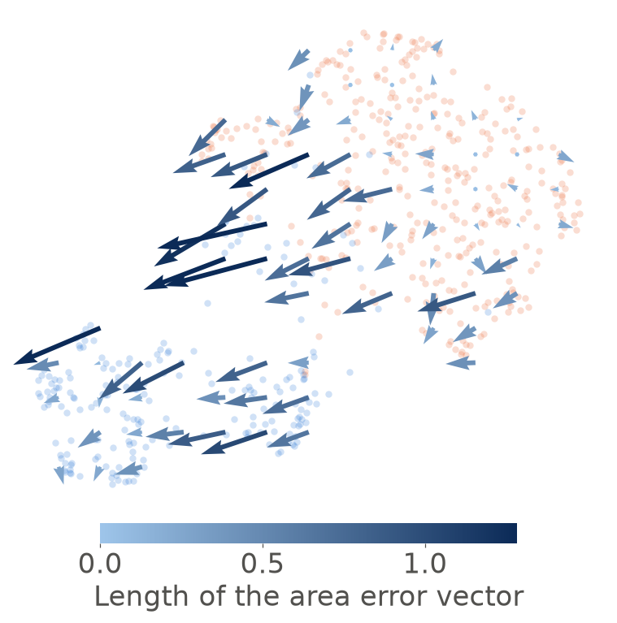{height="700" fig-align="center"}
:::
::::

Left: orange is benign, blue is malignant. Right: influence vectors of area error; darker means larger.

::: {.notes}
Our rerun of Fig. 7 of the paper. Left: the layout, orange is benign and blue is malignant.
Right: the influence vectors of area error; colour is magnitude, darker is larger.

Raising area error moves a boundary point toward the malignant group.

Over the whole dataset, mean concave points and mean area have the highest scores.

Only if asked about the ranking at the boundary: the paper reports area error as the top
feature for hand-picked boundary points. In our rerun with an automatic choice of boundary
points, the direction held for 96 percent of them, but area error ranked 4th at the median
over 10 seeds, behind texture features. So state the direction, not the rank.
:::

## Backup: ablation test

::: {.prov}
Paper, Fig. 5
:::

**Remove the top-15 features of digit class 0: a lower silhouette means those features mattered.**

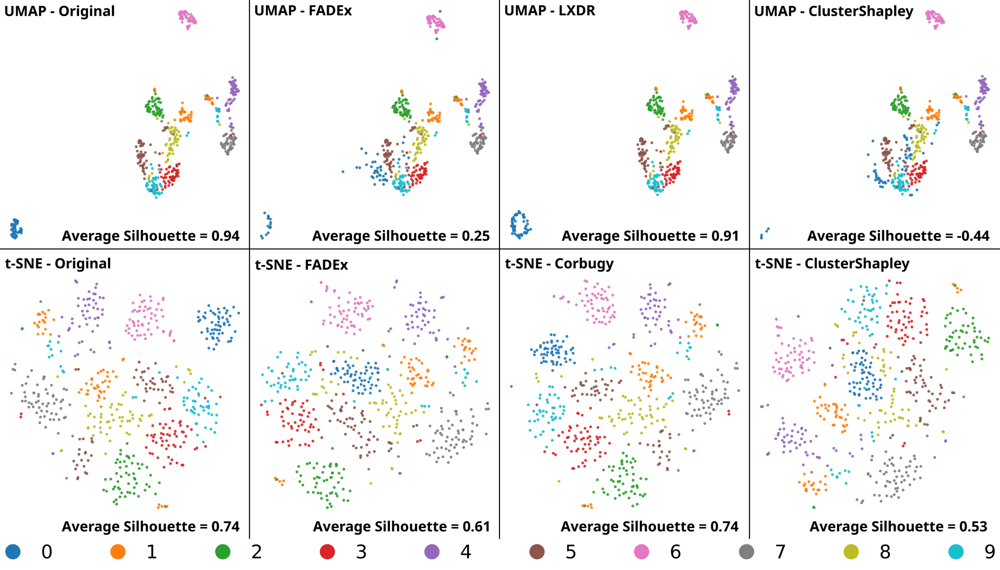{fig-align="center"}

::: {.notes}
Optical digits, 64 features, 10 percent sample, average of 10 seeds.

UMAP: 0.94 originally; 0.25 after FADEx's ablation, minus 0.44 for ClusterShapley, 0.91 for LXDR.
t-SNE: 0.74 originally; 0.61 FADEx, 0.53 ClusterShapley, 0.74 Corbugy.

ClusterShapley is given the cluster labels. FADEx is not.

The procedure. Fit the layout and run FADEx on every digit. Average the score vectors of
the class-0 digits and take the 15 highest pixels. For the class-0 digits only, overwrite
those 15 pixels with an uninformative value. UMAP: push the altered digits through the
fitted mapping, everything else stays put. t-SNE: no fixed mapping, so the layout is
recomputed. Then measure the silhouette of class 0.

In plain terms: a zero is recognisable by a few pixels. Give every zero an average value at
those pixels and it no longer looks like a zero, so the layout places it among other digits.

Blank cells: LXDR needs out-of-sample mapping, which t-SNE lacks; Corbugy is t-SNE only.

Random baseline, from our rerun and the supplement's sweep: removing 15 random pixels
leaves the cluster intact, 0.88 for UMAP and 0.73 for t-SNE.

Only if asked about details. The paper does not state the replacement value or how the
per-digit scores are combined into a class ranking. In our rerun the UMAP number depends on
the replacement: minus 0.24 with the dataset mean, 0.36 with zero; the paper has 0.25. The
t-SNE number reproduced, 0.61. And the test itself uses the class labels (which digits to
average, alter and score), although FADEx computes its scores without them.
:::

## Backup: cost of explaining one instance

::: {.prov}
Paper, supplement Table 1
:::

| Dataset | Metric | FADEx | LXDR | ClusterShapley | Corbugy et al. |
|---|---|---|---|---|---|
| Breast Cancer | Time (s) | **0.02** | 0.19 | 0.13 | **0.02** |
| | Memory (MB) | **6.42** | 9.96 | 16.28 | 9.26 |
| Musk v2 (2,000) | Time (s) | **0.07** | 1.38 | 0.53 | 0.28 |
| | Memory (MB) | **12.43** | 19.66 | 58.20 | 64.61 |
| MNIST (5,000) | Time (s) | **0.46** | 1.46 | 7.25 | 2.10 |
| | Memory (MB) | **70.16** | 137.46 | 279.99 | 475.45 |
| Isolet (5,000) | Time (s) | **0.41** | 0.72 | 7.88 | 1.88 |
| | Memory (MB) | **41.23** | 67.85 | 306.84 | 456.27 |

::: {.notes}
Mean of 10 runs. Memory is the peak resident set size increment.

Lowest on all four datasets; ties with Corbugy on time for Breast Cancer.

Each run explains a single instance. FADEx and LXDR use the same neighbourhood size. These
are the paper's numbers (supplement, Table 1).

We reran only the FADEx column, on different hardware: 0.014, 0.019, 0.061 and 0.061
seconds, the same ordering across datasets. The baseline columns were not rerun.
:::

## Backup: Dry Bean, explanation cluster 1

::: {.prov}
Rerun of paper Fig. 8
:::

**Cluster 1 is mostly Seker and Horoz; its top features separate exactly those two classes.**

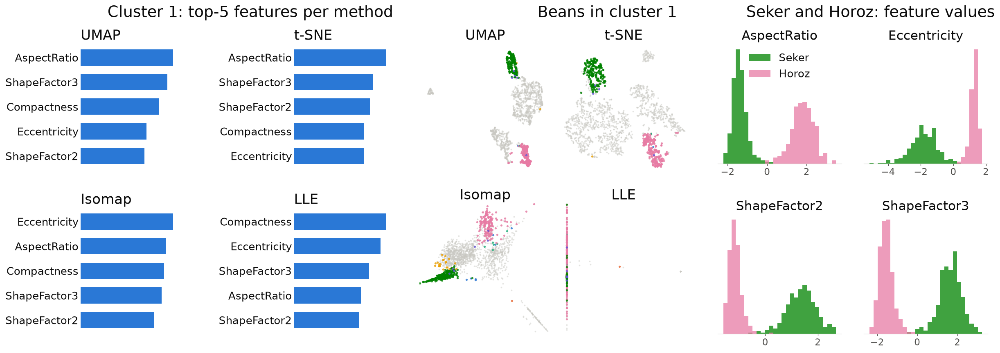{fig-align="center"}

::: {.notes}
Our rerun of Fig. 8 of the paper. AspectRatio, Eccentricity, ShapeFactor2 and ShapeFactor3
are in the top 5 for every method (with Compactness as the fifth), and their distributions
on the right separate the two classes. Seker and Horoz make up 47 and 45 percent of the
cluster.

An explanation cluster is a group of beans explained by the same features. It is not a
cluster in the data or in a layout. Cluster 1 holds about 450 of the 2,000 explanations per
method.

Middle panel: the beans of cluster 1, highlighted in each layout and coloured by class.

If asked why two different classes share one explanation cluster: the score is a magnitude.
Seker is at the low end of AspectRatio and Horoz at the high end, so both are extreme on
the same features, in opposite directions.

AspectRatio, Eccentricity, Compactness and ShapeFactor3 all measure how elongated a bean
is. So read this as "elongation places these beans", not as four separate findings.

The LLE layout is a near-vertical line: with default settings LLE collapses this data to
almost one dimension. It still ranks the same features.
:::
